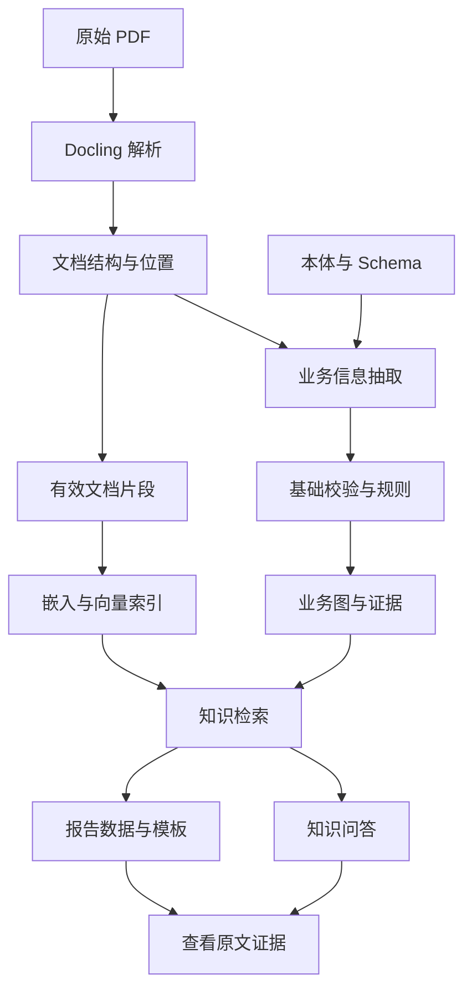
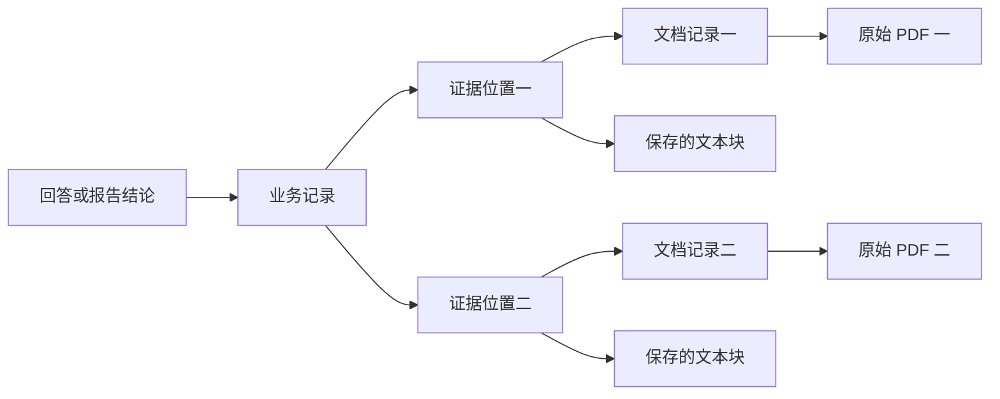
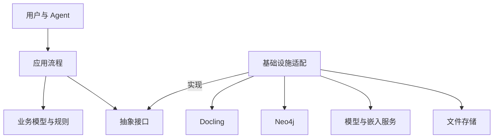

# Ontology-proj 产品需求文档（PRD）

版本：1.1  
整理日期：2026-10-10（Asia/Shanghai）  
目标目录：`/path/to/user/project/ontology-proj`  
状态：需求与取舍已汇总；不表示代码、样本、数据库或 Agent 已经实现。  
主要依据：前序需求、[MVP 范围与业务建模讨论交接](MVP范围与业务建模讨论交接.md)及 2026-10-10 用户确认：测量指标待选样后定稿，首版报告限定为病害与观测汇总。本文供新会话直接接手；交接文件保留为历史讨论记录，其“尚未同步”描述指当时状态。

## 1. 接手摘要：先读这一节

本项目面向路桥检测公司的资料与报告场景，是一个用于学习、面试演示的小型工程项目。重点是分层架构和可核验的端到端流程。通过成熟组件承担通用能力，由项目自己定义业务模型、接口、校验和流程。

从业务功能上，项目只有三个核心模块：

1. **资料录入**：保存 PDF 和解析 JSON，抽取并校验业务实体及关系，关联原文证据。
2. **知识问答**：根据已录入知识回答问题，为事实性结论提供可回查依据。
3. **可追溯报告生成**：按固定结构生成报告，为关键事实关联业务记录和原文位置。

质量审核是辅助流程与扩展方向，首版不新增第四个核心业务模块。

| 决策 | 当前约定 | 状态 |
|---|---|---|
| 文档解析 | 接入 Docling，不自行开发 OCR、版面和表格识别算法 | 已确定方向，样本效果待验证 |
| 图与向量存储 | 使用 Neo4j 保存业务图、证据、文档片段，并使用其向量索引 | 已确定方向，版本和部署方式待选 |
| 原始文件与完整解析结果 | PDF、完整解析 JSON 放在应用管理的持久化文件目录；Neo4j 保存元信息和存储键 | 已采纳方案 |
| PDF 去重 | 对原始文件字节计算 SHA-256，只处理完全相同文件的重复上传 | 用户明确确认 |
| 本体与 Schema | 按业务类型定义概念、关系、字段及校验；同类型实例共用 Schema | 已确认 |
| MVP 业务模型 | Bridge、Component、Defect、Observation、Evidence 五种核心记录；测量并入观测，来源文档轻量登记 | 已确认收缩，测量指标待选样 |
| 证据追溯 | 支持文档、页码、文本块、bbox、charspan；一个事实可关联多条、跨文档来源 | 已确认 |
| 业务规则 | 首版使用有限、明确的规则模块，暂不建设通用规则引擎 | 已确认 |
| Agent | 信息录入 Agent、知识问答 Agent；报告审核 Agent 首版预留接口 | 已确认职责与取舍 |
| 报告 | 一种病害与观测汇总模板；JSON Schema 约束数据，JSON 保存实例，Markdown 负责呈现 | 已确认范围，具体展示细节待定 |
| 置信度 | 保留质量评估与分流接口，首版可默认放行；不实现真实置信度算法 | 已确认边界 |
| 基础校验 | 原文位置、缺失值状态、必填项、类型、单位、对象关联检查进入首版 | 用户明确采纳 |
| 写入控制 | 串行写入、请求唯一标识、图内事务、基础操作记录 | 已采纳方案 |
| 首版不做 | 独立测量实体、专业评估/处治建议/维修记录/条款建模、通用规则平台、高并发、复杂恢复、真实置信度算法、全面语义核验、完整专业报告审核 | 明确排除或延期 |

**授权边界**：2026-10-10 本次请求授权依据讨论交接更新 PRD 与 spec，不授权开始编码、安装依赖、部署或生成简化 PDF，也未要求实施文档目录重构。新会话根据用户当次指令行动；阅读本文不能自动视为实施授权。已有明确授权时，无需重复询问。

## 2. 项目目的与目标用户

### 2.1 项目目的

用一个范围明确、能实际运行的项目，证明对复杂文档解析、知识建模、图与向量检索、Agent 工具调用、证据追溯和分层架构的理解。

展示价值以实际证据为准：能解释一条信息如何从 PDF 进入业务模型、如何被检索、如何支持回答或报告，以及某一步出错时如何发现。组件数量、Agent 数量和图节点数量不是成功的主要依据。

### 2.2 目标用户

| 用户 | 主要需求 |
|---|---|
| 检测资料录入人员 | 导入报告，整理桥梁、构件、病害、观测及原文证据 |
| 检测工程师、专家 | 按对象和检测时间查证，查看原文，提出报告要求并复核 |
| 项目开发者、面试评审者 | 检查架构职责、数据链条、开源复用和实际运行结果 |

目标公司使用场景来自当前讨论，尚未经过真实客户访谈。首版用于演示与学习，不宣称已具备生产平台的可靠性或工程判断能力。

## 3. 范围与优先级

### 3.1 首版必须形成的闭环

文档结构与业务事实是不同数据。图查询和向量检索共同支持知识使用，定位原文则根据证据记录直接读取文件与位置。

### 3.2 范围表

| 能力 | 首版状态 | 范围说明 |
|---|---|---|
| 保存原始 PDF 与完整解析 JSON | 实现 | 本地持久化目录，统一存储接口 |
| SHA-256 精确去重 | 实现 | 重复上传返回已有文档及处理状态，不重复解析和建图 |
| Docling 接入与结构适配 | 实现 | 针对选定 PDF；保留文本、表格、页码和位置；OCR按区域自动跳过/识别，支持关闭与指定物理页强制，边界见 [Spec013](specs/013-ocr-routing/plan.md) |
| 业务本体与 Schema | 实现 | 五种核心记录及轻量来源登记；少量病害类型和测量指标待选样后确定 |
| 业务抽取与基础校验 | 实现 | 候选记录、缺失状态、字段与有限业务规则 |
| Neo4j 图存储与查询 | 实现 | 实体、关系、观测历史、来源关联 |
| 片段向量化和语义检索 | 实现 | 对有效业务文本建立索引；模型待调研 |
| 信息录入 Agent | 实现 | 通过受控工具协调录入，不直接操作底层数据库 |
| 知识问答 Agent | 实现 | 问答与固定模板报告生成，使用真实模型和工具调用 |
| PDF 页面和证据查看 | 实现 | 定位页码与 bbox，展示 charspan 命中文本 |
| 报告数据与引用基础检查 | 实现 | 检查必要字段、引用存在性与来源可访问性 |
| 报告审核 Agent | 预留接口 | 不宣称已经实现自动专业审核 |
| 真实质量评分、置信度算法 | 预留接口 | 默认演示放行；明确记录评分未实现 |
| 90% 自动接纳、10% 人工分流 | 可选演示 | 仅为模拟比例；默认全放行更简单 |
| 专家确认或驳回 | 辅助扩展 | 若演示人工分流，需最小确认入口；完整工作台不要求 |
| 高并发与复杂恢复 | 延期 | 首版采用串行写入 |
| 语义去重、重新解析版本治理、跨任务文件关联 | 延期 | 用户明确排除这些扩展 |
| 自动模糊实体归并、复杂病害生命周期 | 延期 | 使用明确标识或人工固定关联，不自行猜测 |
| 通用规则引擎、规则编辑器 | 延期 | 先用程序化规则模块 |
| 任意报告模板、全面工程规范判断 | 延期 | 一种固定模板；涉及专业判断的能力保留边界 |
| 独立 Measurement、DefectType、InspectionEvent 管理 | 不做 | 测量与必要检测信息并入观测；病害类型用少量受控编码 |
| Assessment、Recommendation、MaintenanceRecord、Clause 建模 | 不做 | 原文可保留检索，不建设评估、处治、维修和标准条款业务能力 |

表中“实现”表示首版计划要求，不表示已有代码或运行证据。

## 4. 样本与业务建模

### 4.1 PDF 素材

用户于 2026-10-12 明确选择平湖市胜利大桥检测报告作为 S5.2 真实验收素材，文件登记、使用范围与独立人工预期见 [真实验收计划](specs/008-system-acceptance/real-acceptance-plan.md)。此前已预读该报告和 2023 年东北公司桥梁病害处治工程的部分代表页；其他候选、链接和前序核验边界见 [讨论交接 §6](MVP范围与业务建模讨论交接.md#6-pdf-样本与核验边界)。选样及前序页面检查不代表 Docling 或业务抽取效果已验证。

依据真实样本生成简化、扩展 PDF 是后续可选工作，目前未生成，也未获得本次生成授权。合成文件与扩展观测必须标记 `source_kind=synthetic`，不将生成内容宣称为实际检测事实。

建议选样覆盖普通段落、检测表格，以及至少一种可展示的复杂格式，如合并表头、跨页表格或清晰扫描页；具体格式随选样确定，不要求三种全部具备。若后续使用简化素材验证流程，仍保留少量原始复杂页面验证解析边界。

本轮具体文件已选，处理页/区域、复杂格式覆盖、独立事实和核查范围仍待确认；既有业务指标按最小业务契约的面积 m² 范围，报告限定为病害与观测汇总，不因新选样自动扩展。以前讨论过的样本数量仅为建议，不是硬性指标。选样后建立独立的预期事实和位置清单；不能用系统自己的输出充当正确答案。

尚未找到可确认同一病害两次实际检测时间的完整报告组合。报告年份、发布日期和引用旧检测结果不能直接作为观测日期；日期缺失保持未知。两次观测可以用明确标记的合成 fixture 验证历史保存机制，但真实多次观测验收须另有原文与身份依据。

### 4.2 概念边界

- **文档结构模型**：描述段落、表格、图片、阅读顺序、页码与位置。复用 Docling 模型，并通过适配模块转换为应用需要的数据。
- **本体**：定义桥梁业务中的概念、含义和关系，例如桥梁包含构件，构件具有病害，病害具有历次观测。
- **业务 Schema**：规定某类业务记录的字段、类型、必填项与基础约束。同类型实例共用 Schema。
- **业务实例**：具体桥梁、构件、某处病害或某次观测。解析 JSON 中的数据经过抽取与检查后成为实例及关系；首版不将条款或评估建成独立业务实例。
- **证据**：支持某个字段、关系或结论的原文及位置。精确定位和真实正确性是不同问题。

本体体现为明确的业务概念、关系和约束。首版不强制部署 OWL/RDF 推理系统，也不能将普通图查询宣称为形式化本体推理。

### 4.3 MVP 业务模型范围

五种核心记录的范围已确认；具体病害编码、测量指标和字段需结合样本定稿，不表示完整 Schema 或抽取效果已经验证。

| 类型 | 含义 | 核心信息 |
|---|---|---|
| Bridge | 桥梁 | 稳定标识、名称及样本中明确的属性 |
| Component | 桥梁构件 | 稳定标识、所属桥梁、构件类型或位置 |
| Defect | 某构件某位置的一处病害 | 类型、所在构件、具体位置、明确身份或关联依据 |
| Observation | 一次观测 | 观测对象、时间、测量值、单位、状态、证据 |
| Evidence | 原文证据 | 文档、页码、原文、可验证位置和所支持的字段 |

每座新登记桥具有稳定内部ID，原文官方编号作为独立属性并带编号体系。报告可通过用户选择、官方编号匹配或唯一精确桥名+完整地理位置自动关联；最后一条按用户明确确认无需人工审核。冲突/歧义/缺信息暂停归属并提示确认，不静默创建或合并；旧已发布身份不自动迁移。构件/病害暂不跨报告自动融合。实现边界见[Spec012](specs/012-bridge-identity/plan.md)。

关系保持为：桥梁包含构件，构件关联病害，病害具有观测，观测关联证据。“有过病害的构件”通过关系查询，不另设类型；每座桥或每处病害也不各建一份 Schema。

| 简化或排除的概念 | 首版处理 |
|---|---|
| Measurement | 少量明确测量字段并入 Observation，保留原值、原单位及转换依据，不设独立 ID 或图节点 |
| DefectType | 少量受控编码或词表，不建设独立定义知识库 |
| InspectionEvent | 必要的时间、机构等并入观测，不管理检测任务实体 |
| SourceDocument | 文档 ID、名称、哈希、PDF/JSON 存储键等轻量来源登记；必要技术状态保留，不扩展文档管理业务 |
| Assessment、Recommendation、MaintenanceRecord、Clause | 不做独立业务建模；原文及可追溯片段仍可保留检索 |

五种核心记录不限制来源登记、解析块、检索片段、报告和操作记录等必要技术结构。

病害与一次观测不能混为一体。测量值及时间属于观测；同一对象在不同时间的数据应保存为不同观测，避免覆盖历史。

跨文档身份关联只使用明确编号或人工固定映射。无法确认身份时保持文档内局部对象，不能仅凭名称或病害类型相同自动合并。

观测、工程判断、原文记载的结论分别表示。未提供规则和依据时，不让模型自动补造等级、严重程度或规范结论。发现未知概念时保留未映射结果，不自动修改本体或 Schema。

保留否定、疑似、近似值和统计范围等限定。“未见露筋”不能生成肯定露筋病害；“全桥若干条裂缝”不能凭空展开成可识别病害对象。缺失日期、数值和对象保持未知。未建模的评估、建议、维修或条款原文须保留其语义类别，不能当作本次观测或已执行维修。

2026-10-13用户确认面积表达兼容：直接面积支持平方米/平方厘米/平方毫米；明确矩形长宽或原文明示面积式可程序派生，原值、计算来源及近似等限定保留。未知/不规则/范围/汇总不猜；仍只输出原MVP业务类型，不新增专业诊断。契约与本轮证据见[业务契约§4.2](specs/001-business-extraction/contract.md#42-observation)、[规则兼容阶段](specs/011-business-rules/plan.md)。

## 5. 业务模块一：资料录入

### 5.1 输入与输出

输入：PDF 文件，必要的桥梁、构件身份或观测上下文，以及预先定义的业务模型；不要求建设检测任务管理。

输出：原始 PDF、完整解析 JSON、适配后的文档内容、候选业务记录、校验结果、正式图记录、证据与有效检索片段。

### 5.2 功能要求

| 编号 | 要求 |
|---|---|
| ING-01 | 对原始 PDF 计算 SHA-256，以原始字节完全一致判断重复 |
| ING-02 | 重复上传复用已有文档，显示实际处理状态，不假定处理一定成功 |
| ING-03 | 保存原始文件与解析 JSON，文件存储不能依赖会被清理的临时目录 |
| ING-04 | 通过适配模块调用 Docling，记录转换失败与可用结果 |
| ING-05 | 保存文档块文本、结构和可用位置，表格保留必要表头、单元格含义与单位 |
| ING-06 | 按五种核心记录的 Schema 形成带原文来源的业务候选；程序负责字段校验、身份关联和固定规则入图，解析 JSON 不直接等于业务知识 |
| ING-07 | 抽取时绑定来源，不能在抽取结束后猜测出处 |
| ING-08 | 检查必填项、类型、单位、对象关联及明确业务规则 |
| ING-09 | 缺失或不确定信息保持未知，不填造日期、数值、条款或标识 |
| ING-10 | 合格记录经统一写入操作进入 Neo4j，保存校验、复核和演示策略信息 |
| ING-11 | 无法合格入库的结果保存失败原因或待处理状态，不冒充完整成功 |
| ING-12 | 保留否定、疑似、近似值与统计范围；不能将否定记为病害、建议记为事实或汇总数量展开成独立对象 |

含自由业务描述的段落和表格单元格，实施默认由模型按 Schema 提出候选，程序负责校验和明确值转换。模型不得生成任意 Cypher、修改 Schema、自行决定校验通过或直接管理数据库。Schema 合法只说明结构合格，不证明语义正确或人工已确认。

规则抽取是可选优化：只有命中已支持并验证的模板且相关表达完全在规则范围内，才使用规则；未处理的限定条件或上下文歧义回退模型，仍不明确时保留未知/待处理。不能以“这是表格”作为充分条件，不建设自由表达比例计算、额外难度判断模型或通用路由引擎。

### 5.3 状态与质量策略

文档处理状态、业务记录校验状态、人工复核状态分别维护。建议至少区分：文档处理中/完成/失败；业务校验通过/未通过/待处理；人工未复核/确认/驳回。

状态在相应操作成功时更新，并保留操作记录，不需要持续轮询来刷新业务核验状态。

**首版置信度占位策略**：基础校验与规则通过后，质量评分接口默认演示放行。实际评分不可用；记录策略为演示默认放行，人工复核状态仍为未复核。

若接口需要展示数值，必须注明其为模拟值，不能把 100% 解释为真实准确率。90% 自动接纳表示模拟路由比例，不是置信度阈值。可选演示采用固定、可重复的每十条一条分流方式，避免随机结果干扰验收。

质量占位不会跳过必填项、类型和业务规则检查。待复核、驳回和失败状态需要在检索侧明确过滤或显示，不能无提示地视为已确认知识。

## 6. 业务模块二：知识问答

### 6.1 用户流程

用户提出问题，必要时指定桥梁、构件和检测时间。知识问答 Agent 通过受控工具检索业务图与文档片段，组织答案，并返回结论与引用。用户可打开原 PDF、定位页面和区域，检查命中文本。

### 6.2 功能要求

| 编号 | 要求 |
|---|---|
| QA-01 | 桥梁编号、构件编号、日期等走精确查询或结构化筛选，不单独依赖向量匹配 |
| QA-02 | 病害描述、检测方法及未建模的评估、建议、维修、条款原文可使用语义检索；注明语义类别，不宣称具有条款适用、评级或维修关系查询能力 |
| QA-03 | 关系问题通过明确实体和关系查询，不能把向量相似度解释为事实关联 |
| QA-04 | 每项事实性结论关联业务记录或原文片段，并提供来源证据 ID |
| QA-05 | 引用不仅存在，还应实际支持对应结论；关键数值优先取自明确记录 |
| QA-06 | 资料不足、时间对象不匹配或来源冲突时明确说明，不自行补齐 |
| QA-07 | 对未经人工复核的数据显示状态；是否可参与演示回答按明确策略执行 |
| QA-08 | 用户可以从引用回查具体 PDF、页码、段落/表格区域及目标文字 |
| QA-09 | 检索范围遵循用户选定的桥梁、构件和时间，避免跨对象串用数据 |

“严格根据知识库回答”是产品目标，需要检索范围、引用检查和运行验证共同支撑。仅编写提示词不等于已证明无幻觉。

## 7. 业务模块三：可追溯报告生成

### 7.1 格式与数据

首版确定为一种病害与观测汇总模板，不承担专业检测报告的评级、原因分析、处治或维修决策。

| 对象 | 形式 | 职责 |
|---|---|---|
| 报告字段约束 | JSON Schema | 规定数据类型、必填项、章节数据和引用结构 |
| 某份报告的数据 | JSON 实例 | 保存对象、时间、事实、章节内容和证据 ID |
| 报告呈现 | Markdown 模板 | 规定标题、段落、表格和引用显示 |

报告要求转为结构化任务：桥梁、构件范围、检测时间范围、模板标识和关注重点。范围已确认；模板的实施默认章节由 spec 定义，S4.1 已固定面积 m²、原值/单位/近似性及五章模板，当前契约见 [Spec 006](specs/006-observation-report/spec.md)。用户选择确定性程序汇总；关注重点仅接受结构化范围，暂不理解自由文字，非空自由要求明确拒绝。

### 7.2 功能要求

| 编号 | 要求 |
|---|---|
| REP-01 | 根据任务范围查询业务图和相关文本，避免无范围地收集内容 |
| REP-02 | 输出结构化报告 JSON，检查后按 Markdown 模板渲染 |
| REP-03 | 关键事实及结论保留业务记录 ID、证据 ID，不能在渲染中丢失引用 |
| REP-04 | 保留观测与判断的区别；总结和推断不能伪装成原文测量事实 |
| REP-05 | 汇总病害与观测，不生成结构化评级、原因分析、处治建议、维修决策或条款依据章节；引用相关原文时仍保持原文陈述的性质 |
| REP-06 | 字段不足时说明缺项，不为填满模板编造内容 |
| REP-07 | 保存报告数据和 Markdown，以及模板信息、生成时间、任务范围和审核状态 |
| REP-08 | 用户从报告引用跳转到原始 PDF 及精确位置 |
| REP-09 | 基础检查覆盖必要字段、章节和引用存在性/来源可访问性 |
| REP-10 | 专业报告审核未实现时明确返回未执行，不能显示审核通过 |

向量索引用于查找相关素材；精确追溯通过证据 ID 和来源记录直接定位，不需要再次向量搜索。

### 7.3 报告审核边界

首版可检查报告中的有限对象、日期、数值是否与图记录一致，前提是报告保留对应结构化字段与记录 ID。此项为可选加强，不扩展为对整篇自由文本重新做全面事实抽取。

完整的证据充分性、规范适用和专业工程判断审核不进入首版。报告审核 Agent 保留接口，状态应为未执行/检查完成/需人工审核等明确含义，不以占位实现假装真实专业审核。

## 8. Agent 与统一工具入口

| 角色 | 首版职责 | 实现状态要求 |
|---|---|---|
| 信息录入 Agent | 调用解析、抽取、校验与提交工具，协调资料录入 | 应真实调用工具并获得结果；若只做固定流水线，明确说明能力范围 |
| 知识问答 Agent | 检索知识、回答问题、按固定模板生成报告 | 问答与报告共用该角色，不另增报告生成 Agent |
| 报告审核 Agent | 未来审核报告事实与规则符合情况 | 首版只预留接口，不计作已实现 Agent |

Agent 角色不等于业务模块或独立服务，也不要求并发运行。普通规则和事务由确定性程序执行，Agent 不替代这些机制。

统一工具入口应明确参数、调用者身份/角色、业务校验、结果与错误。可包含导入、检索、读取证据、生成报告、提交复核等能力；具体接口名和 Agent 框架待调研，不强制 MCP 或特定编排框架。

首版权限可采用简单的调用者与操作许可映射，不要求完整企业登录和 IAM。必须如实区分演示身份与真实认证。

## 9. 来源与证据模型

### 9.1 一条来源记录

| 字段 | 含义与约定 |
|---|---|
| evidence_id | 稳定证据标识，供回答与报告引用 |
| document_id | 对应文档记录，间接找到原始 PDF 与解析 JSON |
| page_no | PDF 页面；项目明确采用从 1 开始，不混用印刷页码 |
| block_id / text_ref | 指向保存后的文档块文本或表格单元格 |
| bbox | 页面区域，需声明顺序、原点、单位与归一化方式 |
| charspan | 指定文本中的字符范围，项目约定零起点、包含起点、不包含终点 |
| target_field | 指明证据支持哪个业务字段；关系或结论可采用对应关联 |
| source_text / quote | 可选命中文本或原文快照，用于核查位置和显示 |

字符偏移必须基于已保存的文本快照，不基于 PDF 二进制，不在文本归一化之后沿用旧偏移。适配 Docling 时确认其字段实际语义，不假定所有工具的坐标和字符约定一致。前后端应统一字符计数或显式转换。

无法准确建立 charspan 时保留不可用状态或转待处理，不能生成虚构位置。首版承诺页码与 bbox 定位、命中文本展示；PDF 上逐字高亮需要字符坐标映射，不列为首版要求。

### 9.2 多处与跨文档来源

一个事实可由多个区域共同支持，每条来源各自绑定文档、页码、文本块、bbox 与 charspan。不能把 bbox 数组和 charspan 数组各自排列，再依赖猜测配对。

跨文档来源必须确认支持同一对象和同一次事实。不同时间的测量是不同观测，不因文字相似合并。

### 9.3 接口结构与 Neo4j 存储

接口可以返回 `provenance` 对象列表。Neo4j 属性不能直接保存任意嵌套对象或对象列表，建议实际保存为多个 Evidence 节点，业务实例通过关系关联证据，证据关联 SourceDocument。

证据链表达来源支持关系，不是模型内部思考过程。精确位置能够帮助核查，但不能替代事实正确性检查。

## 10. 存储与索引职责

| 数据 | 首版位置 | 说明 |
|---|---|---|
| 原始 PDF | 持久化文件目录 | 保留原始字节，SHA-256 去重 |
| 完整 Docling 解析 JSON | 文件目录 | 与原文件关联，保留文本和结构 |
| Schema 与模型定义 | 项目代码/Schema 文件 | 纳入版本管理，不将定义与实例混称 |
| 业务实体、关系、观测 | Neo4j | 图查询与业务事实读取 |
| 文档元信息、证据节点 | Neo4j | 存储键、位置、状态及关联 |
| 有效文档片段和嵌入向量 | Neo4j | 支持语义检索，片段关联来源 |
| 报告 JSON 与 Markdown | 文件目录，图中保存必要元信息 | 具体结构在设计时确定 |
| 操作记录 | 可查询的持久记录 | 具体落在图或日志文件中待设计，需可追踪 |

同一数据库可容纳多种节点类型。文档模型与业务模型不同，不代表必须使用两套数据库。首版不额外引入向量数据库或关系数据库。

只对有检索价值的内容建立向量：业务描述、检测方法、结论、条款，以及保留表头/对象/单位的表格文本。页眉页脚、空白和装饰内容通常排除。编号、日期等结构化字段不需要单独向量化。

嵌入模型生成向量，Neo4j 提供存储与索引。图关系表达明确业务关联，向量相似性只表达检索相关性。首次建索引需要报告是否已可检索；文件已保存不等于所有处理步骤已完成。

文件存储通过统一接口接入，未来可改为对象存储；首版无需部署对象存储服务。应用记录存储键，不把开发者电脑的绝对路径写死进业务规则。

## 11. 分层架构与三条边界

### 11.1 职责划分

| 职责 | 内容 | 依赖要求 |
|---|---|---|
| 接口与 Agent | 用户入口、工具调用、参数与结果展示 | 调用应用提供的业务操作 |
| 应用流程 | 导入、校验、保存、检索、报告与复核的协调 | 依赖业务模型和抽象接口 |
| 领域模型与规则 | 本体、Schema、业务对象与有限规则 | 不导入 Docling、Neo4j 或 Agent SDK |
| 基础设施适配 | Docling、模型服务、Neo4j、嵌入和文件存储 | 实现应用需要的接口，转换外部数据 |

目录层数不作为验收指标。实际依赖方向、接口稳定性和变化实验才是分层的证据。首版可以是单个应用内的模块，不要求微服务。

### 11.2 三条必须保持的边界

1. **解析边界**：业务使用统一文档结构，通过适配模块接入 Docling。
2. **业务边界**：业务概念和规则独立于具体工具、数据库和 Agent 框架。
3. **操作边界**：用户与不同 Agent 共用受控业务入口，执行一致的权限与校验。

图中箭头表达职责依赖，运行时通过组装选择适配实现。不要把运行时数据流误写成业务必须依赖数据库 SDK。

### 11.3 架构验证

- 使用另一份统一解析结果，验证业务抽取不需要理解 Docling 内部对象。
- 不启动模型和数据库，仍能对业务规则运行有意义的检查。
- 通过用户入口和 Agent 工具提交同一非法记录，获得一致拒绝结果。
- 替换测试存储或模型适配，展示上层改动范围；不宣称所有替换必然零改动。

## 12. 基础可靠性与错误处理

### 12.1 首版保障

- **请求去重**：每次提交有唯一请求标识，重复执行返回一致结果或明确已有状态。
- **文件去重**：SHA-256 表达文件身份，和请求身份分开。
- **图内事务**：同一次业务写入的关联节点和关系尽可能作为一个整体提交。
- **操作记录**：至少包含调用者、操作类型、请求标识、对象、时间、结果及失败原因。需要时记录前后状态。
- **串行写入**：首版不承诺多 Agent 并发修改一致性。

图事务不自动覆盖文件目录、模型服务和索引生成。发生跨步骤失败时记录实际状态，允许人工定位和重试；自动补偿、复杂恢复列入后续方向。

### 12.2 最小错误场景

| 场景 | 要求 |
|---|---|
| 同一 PDF 再次上传 | 不重复处理；返回已有记录及真实状态 |
| PDF 无法解析 | 保留失败原因，不进入成功状态 |
| 必填信息缺失 | 未知/待处理，不填造值 |
| 证据或对象不存在 | 不静默保存为合格业务事实 |
| 模型调用失败 | 返回明确错误，不用空回答冒充成功 |
| 查询无依据或来源冲突 | 明确说明，不编造结论 |
| 写入失败或重复请求 | 图内无明显半成品，记录可追踪 |
| 报告审核接口未实现 | 返回未执行，不返回通过 |

## 13. 界面与交互范围

前端形式尚未选定。优先采用能演示业务流程的最小交互，暂不要求复杂管理平台或精细视觉设计。

应能够导入文件、查看状态、提问、提出固定模板报告任务、查看输出和引用、打开 PDF 页面及证据区域。仅有 CLI 可以证明流水线，但若要展示点击回查证据，需要补充适合的查看入口。

人工复核入口根据演示需求决定。若采用 90/10 分流，就必须有最小待复核查看和确认/驳回操作，不能只有队列没有处理结果。

## 14. 验收与证据

以下是功能验收条件，不是已达到的测试结果。样本数量和质量目标在选样后确定，不预填准确率、召回率或生产可靠性指标。

| 编号 | 验收项 | 可展示证据 |
|---|---|---|
| AC-01 | PDF 与解析 JSON 持久保存，系统重启后仍可读取 | 文件读取与重启结果 |
| AC-02 | 相同 PDF 重传不重复解析和建图 | 前后文档/业务记录及处理日志 |
| AC-03 | 选定复杂样本能解析或明确报告失败区域 | 原页面、结构结果、错误清单 |
| AC-04 | 五种核心记录有明确 Schema 和校验，保留否定/疑似/近似值/统计范围 | 合格、缺失、非法及语义限定样例与结果 |
| AC-05 | 观测关联病害、构件、时间及来源，多次观测不覆盖历史，不自动模糊合并 | 图查询与独立事实清单；合成多次观测须标明，不能算真实历史证据 |
| AC-06 | 一个事实能使用多条证据，并支持跨文档来源 | 查询返回与各自原文定位 |
| AC-07 | 页码、bbox 与 charspan 对应保存的原文 | 页面定位、文本切片与人工核查 |
| AC-08 | 精确查询、关系查询和语义检索承担不同职责 | 同一组代表性问题的结果 |
| AC-09 | 问答事实结论具有支持它的引用；缺资料时明确说明 | 回答、引用、原文及失败用例 |
| AC-10 | 病害与观测汇总 JSON 合格，Markdown 按固定模板呈现，引用和语义限定保留 | 汇总文件、验证结果和证据回查；无结构化专业评估/建议/条款章节 |
| AC-11 | 演示分流和未实现审核有明确状态 | UI/接口输出与日志 |
| AC-12 | 重试提交不重复写入，图写入与操作记录可检查 | 请求结果和图内状态 |
| AC-13 | 三条架构边界有实际验证 | 依赖检查、替换实验、独立规则验证 |
| AC-14 | 区分真实 PDF、合成素材、真实模型结果和模拟能力 | 样本标记与演示说明 |

运行证据至少区分：设计文档、代码实现、测试替身结果、真实 PDF 与真实模型/数据库的结果。不能将模拟结果或接口定义等同于实际 Agent 能力。

建议建立少量人工核验的事实、位置、问答和报告结论样例。记录样本规模、错误类别、处理耗时与模型调用成本，指标来自实际运行。

## 15. 推进顺序与开源复用

下表说明产品层面的推进方向。线性构建步骤、依赖与完成条件以 [MVP 落地清单](docs/mvp-roadmap.md) 为主要维护位置，各步骤的详细任务后续逐项制定。

| 阶段 | 主要工作 | 交付与边界 |
|---|---|---|
| 需求与样本确认 | 选桥梁场景、PDF、报告模板与演示问题 | 明确必要字段、复杂格式与预期事实 |
| 开源调研 | 根据技术职责考察成熟组件、官方文档和参考架构 | 用户下达调研指令后开展；每个职责优先一个主要候选 |
| 架构与契约设计 | 定义模型、接口、存储和状态 | 形成具体可评审设计；遵循用户要求的先方案后实施 |
| 录入闭环 | PDF、Docling、证据、抽取、规则和图入库 | 用真实样本跑通，检查失败场景 |
| 检索与问答 | 精确、关系和语义检索，引用与证据查看 | 验证问题与不足资料场景 |
| 报告闭环 | 报告 JSON、Markdown、引用基础检查 | 生成固定结构的可追溯报告 |
| 架构与演示验收 | 三条边界、可靠性、实际运行证据 | 整理能复现的演示和已知限制 |

开源复用的选择依据包括能力匹配、接口清晰、可封装程度、失败行为、运行环境、许可证和测试经验。不要因参考仓库功能多就将其全部引入。

### 15.1 已查阅的参考链接

这些链接在前序讨论中用于概念核对，尚未作为本项目运行验证过的依赖。开发前应确认版本与实际能力。

| 资料 | 参考重点 |
|---|---|
| [Docling 文档模型](https://docling-project.github.io/docling/concepts/docling_document/) | 文档结构、阅读顺序和来源信息 |
| [Docling 置信度](https://docling-project.github.io/docling/concepts/confidence_scores/) | 文档转换质量；不能代替业务事实准确率 |
| [Docling 来源类型](https://github.com/docling-project/docling-core/blob/main/docling_core/types/doc/common/reference.py) | 页码、bbox 与 charspan 的实际类型 |
| [Docling CharSpan 类型](https://github.com/docling-project/docling-core/blob/main/docling_core/types/doc/common/scalars.py) | 字符范围；适配时确认偏移约定 |
| [Neo4j 属性类型](https://neo4j.com/docs/cypher-manual/current/values-and-types/property-structural-constructed/) | 不能将任意嵌套对象列表直接存为节点属性 |
| [Neo4j 向量索引](https://neo4j.com/docs/cypher-manual/current/indexes/semantic-indexes/vector-indexes/) | 图与向量能力及版本限制 |
| [六边形架构原文](https://alistair.cockburn.us/hexagonal-architecture/) | 接口与适配器隔离外部技术 |
| [Cosmic Python：Repository Pattern](https://www.cosmicpython.com/book/chapter_02_repository.html) | 业务模型与持久化隔离 |
| [Cosmic Python 配套仓库](https://github.com/cosmicpython/code) | Python 架构参考代码 |
| [FastAPI Clean Example](https://github.com/ivan-borovets/fastapi-clean-example) | 模块依赖参考；不要求照搬框架与全部机制 |
| [Python hashlib](https://docs.python.org/3/library/hashlib.html) | SHA-256 与文件摘要 |

## 16. 待确认项与接手约束

### 16.1 尚未确定

| 问题 | 对后续工作的影响 |
|---|---|
| 真实 PDF 的可使用范围与人工验收基线 | 已选平湖市胜利大桥检测报告；处理/外发范围、独立人工预期和核查人见 §4.1 的真实验收入口；选样不自动扩大模型字段 |
| 少量病害类型、测量指标与规范单位 | 五种核心记录范围已确认；选样后定稿具体编码、字段与规则，不预设裂缝指标为必需 |
| 病害与观测汇总模板的展示细节 | 报告范围已确认；确定测量列、说明重点和引用呈现 |
| 后续模型调用预算与嵌入检索验收 | 抽取模型已接入；用户已确认本地 Qwen3 Embedding 0.6B 并部署，见 [部署说明](deploy/embedding/README.md)；项目语义检索与后续调用预算仍待落实 |
| Agent 框架与调用机制 | 决定工具封装，但不改变业务边界 |
| Neo4j 版本、部署方式与运行环境 | 决定索引接口和环境配置 |
| 前端形态与 PDF 查看方式 | 决定证据回查的交互实现 |
| 实施语言与 API 框架 | Python 适合接入 Docling，但尚未作为用户明确锁定的技术栈 |
| 默认放行还是演示 90/10 分流 | 后者需要最小人工确认入口 |
| 时间预算及报告数值核对是否进入首版 | 决定可选加强能力 |

### 16.2 给新会话 Agent 的工作要求

1. 优先保持本文中用户已确认的范围，不擅自增加第四业务模块、维护 Agent、第二数据库、微服务或真实评分算法。
   五种核心记录外不增加独立测量、专业评估、处治建议、维修记录或条款业务模型；规则路由仅按已验证格式增加。
2. 不把报告审核接口、模拟分流和测试替身描述为已实现的智能核验能力。
3. 不把文档结构、业务 Schema、业务实例、原文证据和向量片段混为同一种数据。
4. 不将向量检索用于替代编号/日期精确查询，也不将向量相关性当作证据正确性。
5. 开发前结合当次授权读取适用的 AGENTS.md、检查目标目录及现有文件；保留用户已有修改。
6. 不访问旧项目中的文件或启动服务来假装新项目已有运行证据；确需复用时说明来源与状态。
7. 需要改变范围时先提出具体理由和影响。用户明确要求方案确认后再实施时，遵循该顺序；已有授权不反复索取。
8. 默认中文、结论在前，解释术语时结合桥梁例子。进展区分计划、实现、测试和实际运行。
9. 用表格对比方案，用 Mermaid 表达系统关系；不画纯文本箭头流程图。
10. 新会话如仅要求同步上下文，先复述三大业务模块、三条架构边界、首版范围和待确认项，再根据用户指令继续。

## 17. 难度结论

本项目属于小型工程项目。采用成熟组件、一个业务领域、一种报告模板、串行写入和明确的占位能力，使范围可控。

| 方面 | 难度判断 | 依据 |
|---|---|---|
| 通用组件开发 | 中等 | 复用 Docling、Neo4j 与模型接口 |
| 分层与系统集成 | 中等偏高 | 多种模型、状态和接口需要正确衔接 |
| 业务建模和来源绑定 | 中等偏高 | 对象、时间、字段和原文位置必须匹配 |
| 固定范围问答与报告 | 中等 | 模板与检索范围受控，但需要验证引用 |
| 专业审核、真实评分、高并发恢复 | 高，首版延期 | 涉及语义、业务专业性和复杂一致性 |

上述判断是工程估计，尚未通过本项目样本与运行结果验证。成功标准是可追溯、可解释、能复现的闭环，以及分层边界的实际证据。
