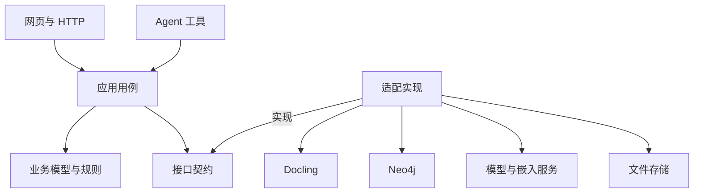
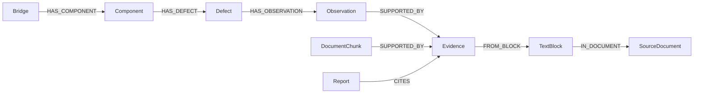

# Ontology-proj 开发规格说明

版本：1.1  
日期：2026-10-10（Asia/Shanghai）  
目标目录：`/path/to/user/project/ontology-proj`  
依据：[PRD.md](PRD.md)、[MVP 范围与业务建模讨论交接](MVP范围与业务建模讨论交接.md)及 2026-10-10 用户确认：测量指标待选样后定稿，报告限定为病害与观测汇总。  
状态：MVP 范围已同步，业务字段以当前最小契约为准；本机骨架的实际能力见 [README](README.md) 与交接。本文其余设计和测试要求不代表系统已经全部实现。

## 1. 使用方式与决策优先级

本文将 PRD 的产品目标细化为架构、数据契约、接口、状态、错误处理和测试要求。获得实施授权后按第 21 节推进。PRD.md 保留产品目标与范围；本文维护实现细节，用户后续明确指令优先。MVP范围与业务建模讨论交接.md 保留为历史讨论记录，其“尚未同步”描述指当时状态；本版已落实范围收缩，不再从旧规格恢复被排除的模型。

下文区分两类决定：

- **已确认需求**：三大业务模块、Docling、Neo4j、SHA-256、五种核心记录、测量并入观测、轻量来源登记、证据追溯、有限规则模块、病害与观测汇总报告、串行写入、审核与评分占位。
- **实施默认**：Python/FastAPI、最小网页、目录结构、字段名、API、状态枚举和可调参数。它们是为了消除实施空白而提供的默认方案，不冒充用户已经逐项批准的技术选型。范围内的等价替换应记录原因与影响。
- **待定设计**：少量病害编码、测量指标、字段名、规范单位及对应报告列在选样后统一；本版不将裂缝宽度/长度或交接中的面积/位移示例设为必须实现的指标。

2026-10-10 本轮授权是更新 PRD 与 spec，不含编码、依赖安装、部署、简化 PDF 生成或文档目录重构。新会话收到实施指令后按已定范围推进；测量相关工作须先完成相应契约定稿。已有明确授权不重复索取。

本文中的本体描述业务概念与关系，例如“构件属于桥梁”；Schema 描述数据的字段与约束；实例是一处具体病害或一次观测。DTO 是跨模块传递的普通数据对象；port 是应用需要的接口，adapter 是该接口的具体实现。幂等表示相同请求重试不会重复创建结果；golden 是人工核验、独立于系统输出的预期结果。

## 2. 产品目标、模块与排除范围

### 2.1 产品目标

面向路桥检测公司的资料使用场景，建立一个用于学习、面试演示的小型知识库。核心价值是：资料进入后可形成业务记录，问答与报告能回查原文，并能证明分层架构发挥了作用。

仅三个核心业务模块：

| 模块 | 输入 | 输出 |
|---|---|---|
| 资料录入 | PDF、导入上下文 | 原始文件、解析 JSON、候选记录、校验结果、业务图与检索片段 |
| 知识问答 | 问题、对象与时间范围 | 结构化答案、事实引用、缺失或冲突说明 |
| 可追溯报告生成 | 报告任务、固定模板 | 报告 JSON、Markdown、引用、检查与审核状态 |

专家复核是辅助操作。报告审核 Agent 是扩展接口，不是第四个首版业务模块。

### 2.2 首版范围

必须实现：保存 PDF/解析 JSON；字节级去重；Docling 适配；业务抽取；基础 Schema/规则校验；Neo4j 图与向量检索；两个实际工作的 Agent 角色；固定报告；页码/bbox 定位和命中文本；请求去重、图内事务与操作记录。

核心记录仅 Bridge、Component、Defect、Observation、Evidence。测量和必要检测信息并入 Observation；病害类型使用少量受控编码；SourceDocument 仅轻量来源登记，保留运行必需状态。来源登记、文档块、片段、报告和操作记录是必要技术结构，不增加独立业务管理模块。

仅预留：真实质量评分、复杂置信度分流、专业报告审核 Agent。默认质量策略为演示全放行，仍执行基础检查。

排除：第二数据库、微服务、分布式队列、高并发、自动跨系统补偿、任意报告模板、全面规范评级、自动模糊实体归并、语义文件去重、重新解析版本治理、跨任务复用治理、OWL/RDF 推理系统、PDF 内逐字坐标高亮。

不建模独立 Measurement、DefectType、InspectionEvent，不实现 Assessment、Recommendation、MaintenanceRecord、Clause 的结构化业务能力；不建设通用规则/路由平台。不生成专业评级、原因分析、处治建议、维修决策或条款依据报告章节。相关原文保留并按语义类别检索，不将原文检索等同于这些业务能力。

首版不宣称生产可靠性、零幻觉或专业结论自动审核。模拟评分、合成素材和未经人工复核记录必须标明。

## 3. 实施默认与环境

| 项目 | 默认方案 | 说明 |
|---|---|---|
| 语言 | Python 3.12 | 对依赖实际安装与样本转换做兼容性检查 |
| 数据契约 | Pydantic v2，导出 JSON Schema | 基础规则保持纯函数；模型不导入数据库/解析器 SDK |
| HTTP | FastAPI，单个应用进程 | `workers=1`；长任务提交后查询状态 |
| 网页 | 同源 HTML/CSS/JavaScript | 三个主入口；不引入大型前端平台 |
| PDF 查看 | PDF.js，资源本地提供 | 页面、区域和文本展示；不依赖浏览器内置 PDF 片段定位能力 |
| 图数据库 | Neo4j Community 5.26.31，项目专用 Docker 容器/命名持久卷；驱动 6.4.0 | ARM64 镜像摘要见 deploy/compose.yaml，部署见 ADR-006；向量索引留到 S3 |
| 解析 | Docling | 复用现成模型与转换器，不训练解析算法 |
| OCR | Docling RapidOCR + ONNX Runtime + PP-OCR | 用户于2026-10-13确定并授权落地；CPU离线，auto/off与指定页强制，契约见 [Spec013](specs/013-ocr-routing/plan.md)，见 [ADR-019](docs/adr/ADR-019-OCR引擎与推理后端.md) |
| 模型与嵌入 | 可配置的提供方适配 | 模型名、地址、凭据和能力需要真实配置，不编造已选模型 |
| 任务执行 | 单进程串行后台 runner | 无 Celery/Redis；任务状态保存到 Neo4j；重启不自动恢复执行 |
| 文件 | 本地持久化目录，可挂载容器 volume | PDF、JSON、报告保留；接口为未来对象存储适配留边界 |
| 测试 | pytest；网页交互用浏览器测试 | 测试替身与真实 provider 测试分开 |

本文未验证完整依赖组合。启动阶段必须完成 Python、Docling、Neo4j 驱动、向量索引与 PDF.js 的最小兼容性实验，将成功版本锁入依赖文件和运行说明。不能使用未锁定的 latest 作为可复现验收环境。

OCR设置与资源：DOCLING_OCR_MODE默认auto（可off），DOCLING_OCR_MODELS_PATH显式本地权重目录，DOCLING_OCR_FORCE_PAGES为唯一正整数JSON数组（1起点物理页），off不得带强制页。自动使用Docling PDF感知版面区域，排除picture/chart及有原生文字且无位图的区域，扫描/混合缺失区域OCR；指定页使用FULL_PAGE并以OCR文字替换该页文字层。模型/依赖预检及SHA固定，不自动下载；失败/空识别返回partial/failed，不发布完整解析。仅有原生页码不应跳过扫描正文。原生文字和向量轮廓混排、坏文字层及版面漏判仍需指定页处理，详见[契约](specs/013-ocr-routing/plan.md)。

### 3.1 设置项

| 设置 | 默认/要求 |
|---|---|
| APP_HOST / APP_PORT | `127.0.0.1` / `8000`；首版仅本地使用 |
| ACTOR_ID | `local_operator`；本机受信任操作者，不接收模型或客户端 actor |
| DATA_ROOT | `./data`，启动时解析为固定绝对路径 |
| NEO4J_URI / DATABASE / USER / PASSWORD | 显式配置；凭据不写入报告、日志或 Git |
| LLM_PROVIDER / BASE_URL / MODEL / API_KEY | 提供方配置；缺失时返回 MODEL_NOT_CONFIGURED |
| EMBEDDING_PROVIDER / MODEL / DIMENSION | 可配置；维度由配置与实际返回共同验证 |
| QUALITY_MODE | `demo_accept_all`；可选 `demo_one_in_ten` |
| MAX_UPLOAD_BYTES / MAX_PAGES | 50 MiB / 100；可调的小样本资源上限 |
| CHUNK_MAX_CHARS / OVERLAP_CHARS | 1200 / 150；不是 tokenizer 的 token 计数 |
| EXTRACTION_MAX_CHARS / GENERATION_CONTEXT_MAX_CHARS | 12000 / 24000；正文预算默认值，需同时满足实际模型 token 上限 |
| SEMANTIC_TOP_K / VECTOR_POOL_LIMIT | 8 / 100；候选扩展后仍须过滤范围 |
| LLM_TIMEOUT / MAX_TRANSIENT_RETRIES | 60 秒 / 2 次 |
| AGENT_MAX_STEPS | 8；超限返回可解释失败 |
| MAX_CANDIDATES_PER_DOCUMENT | 500；超过则显式停止，不静默截断 |

这些是工程默认值，不是性能承诺。Docling 转换时限单独配置并以样本验证；若底层调用不能被安全取消，runner 继续占用并显示状态，不能仅改状态后同时启动第二次转换。

## 4. 分层架构与代码组织

### 4.1 三条边界

1. **解析边界**：应用只接收统一文档模型，由 DoclingAdapter 转换工具内部对象。
2. **业务边界**：业务类型、规则和证据约定独立于 Docling、Neo4j、模型服务、Agent 框架。
3. **操作边界**：网页/API 和 Agent 调用同一套应用用例，权限、校验、去重与记录一致。



箭头表达依赖；bootstrap 负责注入实现。domain 不导入 FastAPI、Docling、Neo4j 和 provider SDK。允许 Pydantic 作轻量数据约束，纯规则不需要外部服务。

### 4.2 目录职责

| 路径 | 内容 |
|---|---|
| `src/ontology_proj/domain/` | 实体、值对象、状态、规则、单位处理 |
| `src/ontology_proj/application/` | 录入、检索、回答、报告、复核用例，权限与操作协调 |
| `src/ontology_proj/application/ports/` | parser、extractor、repository、storage、embedding、generation 接口 |
| `src/ontology_proj/adapters/` | Docling、Neo4j、文件与 provider 实现 |
| `src/ontology_proj/interfaces/http/` | HTTP DTO、路由、错误映射 |
| `src/ontology_proj/interfaces/agents/` | Agent 角色、工具定义与对话循环 |
| `src/ontology_proj/bootstrap.py` | 设置、依赖组装、runner 生命周期 |
| `schemas/` | 导出的业务、答案、报告 JSON Schema |
| `config/ontology.yaml` | 概念、属性、关系及含义；首版固定配置 |
| `templates/bridge_inspection_v1.md` | 固定报告模板 |
| `static/` | 网页与 PDF.js 资源 |
| `tests/unit/`, `tests/integration/`, `tests/e2e/` | 分层测试 |
| `tests/fixtures/` | 独立核验样本、golden facts、位置与问题 |
| `data/` | 运行产物，排除 Git；fixture 可按许可纳入 Git |

新业务概念修改 domain 与抽取契约；新解析器修改 adapter；新用户入口调用原用例。目录拆分本身不算架构验收通过。

## 5. 共用契约与标识

### 5.1 基础约定

- API 与文件 JSON 为 UTF-8；时间戳使用 UTC ISO 8601，页面按 Asia/Shanghai 显示；观测日期单独保存为日期，不从上传时间推断。
- 业务载荷的结构版本、字段与语义以[最小业务契约](specs/001-business-extraction/contract.md)为准，首条应用链路的采用方式见[录入基础计划](specs/002-ingestion-foundation/plan.md)。本文原预留的 `schema_version: "1.0"` 是正式版目标，不表示已实现或迁入时自动升级；文档结构、报告和模板各有自己的版本。不包含版本迁移或重新解析治理。
- 必填字段缺失不得以空串、0 或当前日期代替。可选未知值在 JSON 中为 null；Neo4j 对应属性可不存在。
- Pydantic 禁止未知字段进入正式写入 DTO；抽取多余字段进入 issues，不自动扩展 Schema。
- 测量数量值以 Decimal 处理，选定测量字段的规范值使用十进制字符串保存，避免浮点比较误差。具体字段名在选样后定稿；展示层格式化，业务比较使用 Decimal。
- 外部模型输出只有经过解析、校验和来源匹配后才进入应用用例。

### 5.2 标识生成

| 标识 | 约定 |
|---|---|
| document_id | `doc_` 加原始文件 SHA-256 十六进制摘要；完整摘要用于唯一约束 |
| block_id | 文档 ID 加稳定块序号，来自保存的统一文档；重试复用产物 |
| bridge_id | 新catalog模式为桥登记稳定技术ID，原官方编号独立保存；旧已发布身份保留。归属规则见[Spec012](specs/012-bridge-identity/plan.md) |
| component_id | 新catalog模式由document_id/bridge_id/原构件编号生成文档内键，不跨报告自动合并；旧版本键保留 |
| defect_id | 明确标识或文档内局部标识；局部标识不自动跨文档合并 |
| observation_id | 文档 ID 与候选的稳定 local_id 组成；不同观测时间分开记录 |
| evidence_id | 对来源位置、目标字段和引用文本的规范序列化内容生成稳定摘要 |
| chunk_id | 对文档 ID、源片段范围和实际嵌入文本生成稳定摘要 |
| request_id | 调用方提供或服务端生成 UUID；写操作要求 Idempotency-Key |
| question_id / report_id / operation_id | UUID；与文件/业务身份分开 |
| audit_id | 在事务回调外生成或由 operation+stage+action 确定；驱动重试不得产生第二个 ID |

摘要输入必须明确顺序与编码，不能采用不稳定对象字符串。证据 bbox 规范保留六位小数后参与摘要；字符位置为整数。IDs 可以显示简写，但数据库仍保存完整值。

## 6. 文档与来源数据契约

### 6.1 SourceDocument

| 字段 | 类型与约束 |
|---|---|
| document_id / sha256 | string，必填、唯一 |
| original_filename | string，仅显示，不用于构造存储路径 |
| kind | `inspection_report` / `other`；仅资料分类，不管理标准条款实体 |
| source_kind | `real` / `synthetic`，必填 |
| bridge_id | string/null；无法确认归属保持未知，不凭同名自动关联 |
| pdf_key / parsed_key / normalized_key | 相对 DATA_ROOT 的存储键；未生成产物时为 null |
| bytes / page_count | 非负整数；页数未知为 null |
| processing_status | 见第 11 节 |
| index_status | `not_started` / `running` / `ready` / `failed` / `disabled` |
| counts | 候选、accepted、pending、rejected、可定位块数量；接口对象，图中展开字段 |
| warnings / error_code / error_message | 接口列表或字段；图中列表使用字符串，不嵌套对象 |
| created_at / updated_at | UTC 时间戳 |

上述状态与计数服务于录入、检索和诊断，不引入来源文档审批、版本治理、标准管理或检测任务管理。资料来源性质须传递到观测：真实 PDF 中引用旧检测结果不自动构成本次新观测；合成观测只能来自明确标为 synthetic 的素材/fixture，不能附真实 PDF 证据冒充实际记录。

### 6.2 NormalizedDocument

完整 Docling JSON 单独保存，不丢弃。应用统一 JSON 至少包括 document_id、schema_version、pages、blocks、warnings。S2.1 采用独立文档结构版本 `normalized-0.1`；它不改变业务载荷版本或语义修订。块 ID 按 §5.2 使用文档 ID 与固定遍历序号，重试复用快照；实验的哈希块 ID 与 `experiment-1` 不直接冒充应用版本。

Page：page_no（1 起点）、width、height、坐标单位、rotation、定位支持状态。

Block：block_id、kind（paragraph/title/table_cell/table_row/other）、text、所属层级、source_ref，以及 `locations[]`。每个 location 保存页码、规范化 bbox 和对应块 text 的字符范围。

表格保留 table_id、row、column、row_span、column_span 和明确的表头/单位关联。字段抽取优先基于单元格与行；用于嵌入的线性化文本另存，不能覆盖原始块文本。

Block.text 是字符偏移的权威快照。清洗、重排、加标题和单位归一产生的新字符串有独立字段，不能继续套用旧 charspan。

`normalized-0.1`新增可选`ocr`（revision=`ocr-routing-1`）扩展，保存mode、engine/backend/versions、模型哈希、强制物理页以及pages路由诊断；每页包含1起点page_no、左上角归一化regions、reader_calls、recognized_cells（原识别数量）、ocr_cells（合并后保留数量）、reason/status及elapsed_seconds。操作diagnostic.json可选ocr同样保存；Docling原生JSON不插入该应用字段。OCR结果text/位置仍通过既有统一块适配，字符偏移以保存文本为准，不修改原生结果以修正识别错误。旧操作/快照无ocr字段仍可读，不自动升级。

`normalized-0.1`新增可选`structure`扩展（revision=`document-structure-1`），不改变现有文字块ID、text、charspan或表native_data。包括`native_picture_regions`（原生区域）、`pictures`（PDF图片每次出现的picture_id、页、bbox、pixel_size、PDF页对象source_ref）、`relations`（picture_caption/table_cell_continuation）、`diagnostics`和`source_layout`。图片位置为region，不造文字charspan。source_layout为本地PDF实际几何补充，随新统一JSON保存，原Docling JSON不改。

关联保留原块引用、位置证据、method及`status=derived`，不代表人工确认或专业事实；歧义/缺证据不关联并记录诊断。续行关系保存目标table_id/row/column/target_block_id及continuation_block_id，原文不拼接覆盖。跨页仅窄范围几何/框线/行标记满足时派生，不能只凭邻近或图号猜绑定；规则与字段维护在[文档结构计划](specs/010-document-structure/plan.md)。图片二进制不加入业务生成载荷，本轮不改变业务抽取Schema或图模型。旧发布快照不自动升级。决定理由见[ADR-016](docs/adr/ADR-016-文档图片与来源几何补充.md)。


### 6.3 Evidence

每条证据是一个不可变位置记录。修改位置需要新记录，不静默修改已生成报告引用。

| 字段 | 类型与约束 |
|---|---|
| evidence_id / document_id / block_id | string，必填 |
| page_no | integer >= 1；必须存在于该文档 |
| bbox | 四个 float，顺序 `[x0,y0,x1,y1]`，归一化左上角坐标，范围 0..1，x0<x1、y0<y1 |
| charspan | 两个 integer `[start,end]` 或 null；0 <= start < end <= 原块字符数 |
| quote | string；有 charspan 时等于原块的对应切片 |
| target_field | string，说明支持哪个字段/关系/结论 |
| location_level | `span` / `region`；不可精确切片时不得写 span |
| source_ref | Docling 对象引用/单元格引用，供诊断 |

跨页、跨段或跨文档证据拆成多条完整记录；同一个业务实例的 provenance 返回这些记录的列表，不使用 charspan1、charspan2 等扩展字段。

字符计数采用 Unicode code point，与 Python 字符串切片一致；前端读取接口 quote 或进行一致转换，不直接用 JavaScript UTF-16 索引解释偏移。

### 6.4 坐标转换与目标文字匹配

DoclingAdapter 将可用坐标转换为项目规范：左上角、页面尺寸归一化、页面从 1 起点。保留原坐标信息用于诊断。普通未旋转页面中，左上角坐标按 width/height 归一；左下角坐标还需翻转 y 轴。

旋转页面必须基于页面旋转和查看器 viewport 明确转换。若尚未支持该转换，标记位置不可用并显示原页面，不绘制错误区域；首批验收素材选择有可验证位置的页面。记录这一已知边界。

抽取模型输出 block_id 和 exact_quote；系统在保存的 Block.text 上计算 charspan。唯一匹配可接受；多次匹配需明确位置提示并验证，否则只保留可核查区域或待处理；零匹配为 EVIDENCE_QUOTE_MISMATCH。不能让模型凭空计算位置后未经校验直接保存。

对于表格目标值，证据可分别关联数值单元格、表头和单位单元格；规范化测量同时保留原值原单位。bbox 定位展示矩形，charspan 展示对应文字；PDF 逐字像素高亮不属于首版。

无可验证页码/bbox 的块可保存在统一文档中，location_status 为 unavailable；不能创建伪造的 Evidence，也不能进入首版可追溯检索。相关候选进入 pending，并说明位置缺失。

## 7. 业务数据契约

当前0.4.0-draft/catalog身份基础为语义1.4，桥ID与原官方编号分开、唯一桥名+完整位置自动关联；主契约见[§10](specs/001-business-extraction/contract.md#10-桥梁统一身份语义14)/[ADR-018](docs/adr/ADR-018-桥梁统一身份与报告归属.md)。2026-10-16普通抽取语义1.5补充同构件部位粒度、无观测编号的严格普通行证据及结构载荷，主定义和独立预期见[Spec014](specs/014-catalog-evidence/plan.md)/[ADR-021](docs/adr/ADR-021-普通表格业务行证据闭环.md)。以下带日期段落保留各历史基线，不能当作当前仅支持0.1/0.2或仍未同步的状态。旧发布不迁写，0.4面积规则沿1.3。

受控登记补充见[最小契约§9](specs/001-business-extraction/contract.md#9-受控人工登记语义12)/[ADR-015](docs/adr/ADR-015-受控人工身份与原文编号分离.md)：新增0.2.0-draft，原文编号缺失仍null、内部身份由同文档人工登记提供，字段来源限明确源窗口，m 2仅排版等价归一。旧0.1及旧结果兼容不改；实施/实测以[任务](specs/009-controlled-registration/tasks.md)为准，不据此宣称S5.2通过。

2026-10-11 用户已逐项确认并授权落成语义修订 1.1，规则集中维护于 [最小业务契约 §4.4](specs/001-business-extraction/contract.md#44-位置规范桥头部位与构件分开语义修订-11)、[§5.1](specs/001-business-extraction/contract.md#51-检测事实与说明文字的分类语义修订-11)、[§6.1](specs/001-business-extraction/contract.md#61-说明文字的可选组件关联与上下文证据语义修订-11)：检测事实与说明分流、当前样本桥头位置规范、可选组件关联须有可回查上下文。机器结构/schema_version 仍为 0.1.0-draft；本轮只落契约，提示词/校验程序及新实验基线 1.1 尚未同步或运行，不改旧实验判定。

2026-10-10 已按用户授权形成 [最小业务抽取契约](specs/001-business-extraction/contract.md)及 [JSON Schema](specs/001-business-extraction/business.schema.json)，以当前 synthetic 样本细化候选/记录形态、面积字段、身份、证据和图映射。用户已认可设计，作为单样本抽取实验基线；字段只维护在该入口；2026-10-13用户授权新增0.3.0-draft及语义1.3面积表达兼容，旧0.1/0.2保留，不代表以下总体默认已全部定稿或实现。契约增加原文 `statements[]` 分类载荷，不增加业务实体或图节点；迁入正式应用前再同步本节与相关验收约定。

2026-10-11 已通过用户指定的本地 API 中转，完成实际候选抽取、实验程序校验及核心事实对照；证据与适用边界见 [单样本抽取验收](experiments/business-extraction-001/results/review.md)。本次仅验证当前 synthetic PDF，不代表 Neo4j、通用语义或系统验收通过。

### 7.1 共用记录状态

需要接纳和复核的业务实例保存 validation_status、acceptance_status、review_status、quality_mode、quality_score、evidence_ids、source_document_id。

| 字段 | 允许值 |
|---|---|
| validation_status | `passed` / `failed` / `pending` |
| acceptance_status | `accepted` / `pending_review` / `rejected` |
| review_status | `unreviewed` / `confirmed` / `rejected` |
| quality_mode | `demo_accept_all` / `demo_one_in_ten` / `real` |
| quality_score | null；模拟/真实数值只有注明来源时可增加，首版默认不填 |

默认正式图仅写 accepted 或满足结构要求的 pending_review 记录。结构非法的 rejected 候选保存在 candidates.json，不进入正式业务节点。查询默认过滤 accepted；confirmed_only 可进一步只查人工确认。

合法默认组合：passed+accepted+unreviewed（演示自动接纳）；passed+pending_review+unreviewed（待人工）；passed+accepted+confirmed；passed+rejected+rejected（人工驳回）。failed 不得 accepted。复核状态转换不重新伪造质量分。

### 7.2 实体与字段

以下是五种核心记录的项目契约。字段名为实施默认；少量病害编码与测量字段尚待选样定稿。标记 nullable 的字段允许未知，不补造值。

| 类型 | 必填字段 | 可空/其他字段 |
|---|---|---|
| Bridge | bridge_id、name、evidence_ids 或明确导入上下文 | 外部编号、位置；不生成未提供的属性 |
| Component | component_id、bridge_id、component_code | component_type、location_text、evidence_ids |
| Defect | defect_id、component_id、defect_type、identity_scope | 外部病害编号、location_text、原始类型/描述、evidence_ids；身份仍需明确编号或人工固定关联依据 |
| Observation | observation_id、component_id、defect_id、evidence_ids、source_kind | observed_at、observer、inspection_organization、description、语义限定、选定测量字段、missing_fields[] |
| Evidence | evidence_id、document_id、block_id、page_no、quote、可验证 bbox、target_field | charspan、source_ref；完整约定见 §6.3 |

测量不设独立实体、ID、measurements[] 契约或图节点。选样后为 Observation 定稿少量明确测量字段及规范单位，并保留原值、原单位、转换依据、近似等限定及字段对应 Evidence。数值使用 Decimal 字符串；允许未知值为 null，不填零。不用任意键值对象绕过字段约束，也不将任意嵌套对象直接写进 Neo4j 属性。未映射测量留在原文/候选 issues 中，不自动扩展正式 Schema。

测量字段定稿时需同时列出：指标含义、字段名、原值/规范值/单位/限定的对应方式、必填或可空条件、转换规则、图标量属性映射、Evidence.target_field、报告列和断言字段。本文不预设裂缝宽度/长度、露筋面积或位移必须进入首版。

Observation 可有未知日期，但必须显示 missing_fields；带日期范围的查询不纳入未知日期观测，并返回omitted_unknown_date_count及有遗漏时的warning；只统计许可候选中被日期条件排除的未知日期，未施加日期条件时为0。没有足够对象/证据建立观测时进入 pending，不猜测。

Defect.identity_scope：`explicit` 或 `document_local`。明确标识或导入映射可跨文档复用；局部对象不自动合并。不同时间的观测各自独立。Bridge/Component 使用明确 ID，不能仅凭同名模糊归并。

DefectType 使用受控编码及原始术语，不设定义知识库。检测时间、机构等按需要并入 Observation，不设 InspectionEvent。SourceDocument 契约仅服务轻量登记。专业评估、处治建议、维修记录与条款仅保留原文和片段，不产生被排除类型的 ID 或图关系。

语义校验必须保留否定、疑似、近似与统计范围：“未见露筋”不能产生肯定露筋对象；“疑似裂缝”不能归一为无条件已确认裂缝；近似值不能展示为精确测量；“全桥若干条裂缝”不能展开成可识别 Defect。无法安全表示或确定身份的候选进入 pending，原文仍保留。只有可识别的一处病害及相应观测可按该模型提交；汇总、评估、建议和维修原文不能作为独立观测冒充入图。语义限定的具体字段随样本定稿，基础校验通过与人工 confirmed 仍分开。

Observation.source_kind 从对应来源文档继承 real/synthetic 并在查询与报告中显示；不能用真实文件的哈希为虚构第二次观测背书。观测日期必须来自原文明示或可核验上下文，报告年份、发布日期、文件上传时间或旧检测引用的所在文档年份不能替代它。

### 7.3 业务单位和规则结果

选样后只实现已定稿指标的单位规则；长度、面积等必须分别校验量纲。明确的单位转换使用 Decimal 的固定比例并保存依据，未知、矛盾或指标不适用则 pending/rejected，不猜默认单位。不在本文设定工程评级阈值。

规则纯函数接收业务记录、引用对象摘要与来源验证结果，返回：

```json
{
  "validation_status": "pending",
  "issues": [
    {
      "code": "UNIT_UNKNOWN",
      "severity": "pending",
      "target": "<待定测量字段的单位字段>",
      "message": "原文未提供可确认单位"
    }
  ],
  "rule_version": "basic-v1"
}
```

上述 target 是尚未定稿的占位说明；实际规则结果必须使用选样后定稿的具体字段名，不能输出占位文本。

基础规则：必填与类型、日期格式、有限枚举、值域/非负、指标单位、对象存在及所属桥梁、原文位置、引用文本匹配。未来日期可提示，不凭空采用上传日期修正。

Observation.component_id 必须与其 Defect 的构件一致；测量字段属于该次观测，字段引用必须有匹配原值、单位和语义限定的来源。日期范围两端存在时 date_from <= date_to；列出的 component_ids 必须属于 scope.bridge_id。关系候选要检查合法两端类型，不能只确认 ID 存在。

### 7.4 候选抽取契约

Extractor 输入统一文档中受限的块、导入上下文、业务 Schema 和抽取约束。输出 CandidateBundle：document_id、schema_version、entities[]、relations[]、issues[]。业务实体候选只允许 Bridge、Component、Defect、Observation；Evidence 由 sources 经程序匹配位置后建立，SourceDocument 由上传登记建立。被排除类型不得作为实体候选绕过范围。

每个候选有 local_id、entity_type、data、sources[]。sources 包含 block_id、exact_quote、target_field 及可选 occurrence_hint。候选保留原始术语、原句及否定/疑似/近似/统计范围等限定，不能只抽关键词和数字。relations 使用本次 local_id 或经过许可的已有 ID。

系统负责 ID 生成、值转换、证据匹配、引用对象解析和接纳。模型不得输出 Cypher、修改 Schema、选择文件路径或自己决定通过校验。

候选之间有依赖时先解析 Bridge/Component/Defect，再解析包含测量字段的 Observation；依赖失败的候选不能通过。单个非法候选不必导致整个文档丢弃，但需显式保留 rejected/pending 数量和原因。

按块分批抽取，避免整份 PDF 无限制塞进模型。每批保留桥梁/构件上下文与必要表头，候选 local_id 在 document+batch 命名空间内唯一。保存已验证候选快照后，写图重试复用该快照，不再次抽取。生成上下文按检索排名与预算选取，保存实际提供的 IDs；范围信息与规则不可因裁剪而丢失。单块仍超出模型能力时返回 MODEL_CONTEXT_TOO_LARGE 或待处理，不静默截断证据。

### 7.5 规则与模型的抽取路由

实施默认：模型处理含业务描述的段落与表格单元格，确定性程序负责校验、身份关联及明确值转换；模型不负责固定图写入规则。结构合格不代表事实或语义正确。

规则捷径是后续可选优化，采用少量已支持并验证的模板/句式：完整覆盖表头、字段、单位、上下文及语义限定才允许规则抽取；未命中、未处理的描述或歧义回退模型；模型也无法处理时保留未知、原因或 pending。配置可写在代码或独立文件，不强制规则平台。

不能因内容是表格就选择规则，不能只匹配病害关键词及数字后忽略“未见/疑似”等限定。不计算自由表达比例，也不额外调用模型判断难度。路由不是闭环前置条件；每次增加规则捷径须用独立预期样例验证规则命中和回退行为。

## 8. 文件布局与原子保存

运行路径均为 DATA_ROOT 下的存储键，不能由原始文件名或模型输出任意指定。

| 存储键 | 内容 |
|---|---|
| `documents/{document_id}/source.pdf` | 原始字节 |
| `documents/{document_id}/source.json` | 本地来源登记草稿，不是正式图登记或状态权威 |
| `documents/{document_id}/docling.json` | 完整解析结果 |
| `documents/{document_id}/normalized.json` | 应用统一文档 |
| `documents/{document_id}/candidates.json` | 候选、规则结果、拒绝原因 |
| `documents/{document_id}/chunks.json` | 切块与来源清单 |
| `documents/{document_id}/manifest.json` | 产物及阶段校验摘要 |
| `answers/{question_id}/` | S3.3 input/context/request/response/validation/answer 独立快照；失败不发布 answer |
| `reports/{report_id}/report.json` | 报告结构化数据 |
| `reports/{report_id}/report.md` | 渲染结果 |
| `operations/{operation_id}/diagnostic.json` | 必要诊断，敏感内容默认不保存 |
| `operations/{operation_id}/docling.json` | 该次解析返回的原生快照，存在原生结果时保留，不覆盖 |
| `documents/{document_id}/business-runs/{run_id}/` | S2.2 独立抽取尝试：request/response/candidate/validation/records/diagnostic；失败不生成可用 records |
| `documents/{document_id}/business-manifest.json` | S2.2 业务发布摘要，绑定解析 manifest 哈希及抽取运行文件，不替代图状态 |

写文件使用同目录临时文件、flush、原子 rename；失败时不能将未完成文件标为可读产物。图中保存存储键、状态和必要摘要。

不承诺文件与 Neo4j 的跨资源原子事务。上传先保存文件，再登记图元信息；登记失败可留下文件，明确记录失败并允许同哈希重传重新登记。不得把文件已存在当作图登记成功。

Document 的阶段状态以 Neo4j 为权威；manifest 仅用于校验和诊断。文件/元信息不一致时返回 ARTIFACT_MISSING 或 ARTIFACT_MISMATCH，不静默返回空内容。新来源在documents下临时目录写齐并同步PDF/元信息后一次重命名为最终doc目录；异常/进程中断的staging不发布、同哈希可重传，不覆盖已有来源。旧最终目录缺元信息或被篡改仍明确拒绝，无法仅凭缺文件区分旧崩溃与删除，不自动清理；存储决定见[ADR-011](docs/adr/ADR-011-来源文件成对发布.md)。

### 8.1 S2.1 本地准备与 S2.3 正式登记

用户已确认先以命令行调用共享应用用例验证本地保存与解析，正式上传/处理/状态 API 与图来源登记在 S2.3 接通。决定理由见 [ADR-004](docs/adr/ADR-004-本地解析与正式图登记分阶段.md)，具体任务见 [Spec 002 plan §8](specs/002-ingestion-foundation/plan.md#8-s21-文件来源草稿与解析详细计划)。这仅改变分阶段实施入口，不改变最终录入接口或 Neo4j 状态权威。

`source.json` 必填：document_id、sha256、original_filename、bytes、kind、source_kind、bridge_id（可为 null）、created_at（UTC）、pdf_key。document_id 按 §5.2 生成；source_kind 必须显式提供，bridge_id 不按名称猜测。文件名只供显示，存储键由程序生成。此草稿不包含病害答案、观测日期或正式 processing_status；实际页数、解析键及配置摘要由产物 manifest 维护。

同哈希重复提交复用已有来源草稿与有效产物，不自动重新解析。kind/source_kind/bridge_id 与已有草稿不同则返回明确上下文冲突，不静默覆盖；原始文件名不同仅作为重复提交显示信息，不改已有身份。失败/中断后的再执行须显式请求，重传不触发重跑。首版不支持改变解析配置后覆写已完成快照。

manifest 记录文档 ID、源哈希、文档结构版本、解析配置及依赖版本、各已发布产物的相对键/哈希/字节数、解析告警与完成操作 ID；不包含自己的哈希，不存凭据或机器绝对路径。原生/统一产物逐一原子保存、核验后最后发布 manifest；仅有部分文件不能判定解析完成。读取已发布产物时发现缺失/不匹配分别报 ARTIFACT_MISSING/ARTIFACT_MISMATCH；首次尚未生成与完整性错误区分。

本地 diagnostic.json 记录操作 ID、文档 ID、阶段、操作结果与脱敏错误。可以使用 §11 的 Operation 状态词汇，但必须标明本地解析操作，不得冒充图中正式 Operation/Document 或 graph_ready。重启恢复须确认前一个进程已停止：无有效发布结果的未完成本地操作标 interrupted，不自动续跑；manifest 已发布而最终诊断尚未保存时，根据已核验 manifest 补记成功，不重新解析。已完成快照可重新读取。并发操作不得覆盖同一文档产物，沿用单进程、共享存储实例串行默认，不承诺跨进程并发保护。

每次解析若返回原生结构，先保存不可覆盖的操作级 docling.json，再保存文档级候选产物；失败或部分转换的原生快照在显式重试后仍保留。没有 manifest 的文档级产物只作未发布候选，不通过完成结果读取入口返回；有效已发布结果和损坏的已发布结果均不自动覆写。

S2.1 本地 CLI 使用独立入口 `python -m ontology_proj.local_cli`，由顶层加载配置并注入共享用例；prepare 保存 PDF 与显式来源上下文，parse 按文档 ID 解析且重试须显式指定，read 只读取核验后的已发布产物。全局配置参数置于子命令之前；成功 JSON 写 stdout，失败 JSON 写 stderr，退出码 0/1/2/130 分别表示成功、处理失败、参数或配置错误、用户中断。命令用法与实际证据见 [README 本地 CLI](README.md#本地-cli)。该入口不改变 HTTP /health、/ready 或正式录入 API 的语义。

S2.3 正式登记须重新核验草稿、原文件与已发布产物的一致性，并在 Neo4j 建立 SourceDocument/正式操作状态；本地解析已完成不等于登记成功。文件存储和图登记失败仍遵守 §8 的跨资源边界。

S2.2 本地抽取通过 extract/read-business CLI 调用共享用例。业务尝试与解析操作目录隔离，最后发布独立 business-manifest，已通过结构/语义/记录校验才有 records；缺项保留契约约定的 pending_review。失败保留响应和诊断，显式 fresh 新建尝试；读取不调用模型，缺失/篡改不静默修复。改变配置需新基线目录。本地成功不证明事实完整或稳定性通过；独立五份各两次首次 10/10 门槛见 [plan §9](specs/002-ingestion-foundation/plan.md#9-s22-业务抽取与独立稳定性详细计划)及 [ADR-005](docs/adr/ADR-005-S2.2独立稳定性与结果发布.md)。

当前固定基线 1.1.4 已通过该门槛，见 [S2.2 持续修复与复验](specs/002-ingestion-foundation/results/s2.2/stability-followup.md)，前轮失败保留。请求 Schema 按实体/关系/说明限定已有来源字段，主 Schema 不变；引文优先完整块，组织说明缺少本句构件信息时采用允许的空关联。S2.3 已接通正式图/API/runner/业务恢复，见 [验收](specs/002-ingestion-foundation/results/s2.3/review.md)；抽取核心与请求保持一致，完整应用新增基础设施，不宣称旧整包冻结仍等于当前源码。受控样本完成不代表复杂真实报告能力。

## 9. Neo4j 模型、写入与索引

### 9.1 节点和关系



Bridge/Component/Defect 的证据也使用 SUPPORTED_BY。Observation 的测量作为选定标量属性保存，Evidence.target_field 区分支持的具体字段，不建立测量节点。Evidence 同时保存 document_id，并通过 TextBlock 找到 SourceDocument。Report 保存任务范围和产物键；大段报告 JSON 不嵌入图属性。

TextBlock 保存 block_id、document_id、text、kind 和页面标识；完整复杂表格仍在 normalized.json。DocumentChunk 保存 chunk_id、document_id、text_for_embedding、embedding 与绑定模型/维度等配置的 profile；来源跨度、记录关联与独立索引状态由 [Spec 004](specs/004-semantic-context/spec.md) 细化。

Neo4j 不直接保存任意嵌套对象/对象列表。选定测量的规范值、原值、单位及转换依据映射为 Observation 上明确的标量属性；provenance 映射为 Evidence 节点及关系，issues 保留在候选快照或展开为受控诊断字段。具体测量属性名与 §7.2 同步定稿。bbox 和 charspan 可保存为同类型数值列表；不将所有业务实体统一序列化为 JSON 字符串而失去关系查询能力。

### 9.2 唯一约束

SourceDocument.document_id 与 sha256、TextBlock.block_id、Evidence.evidence_id、每种业务类型的主标识、DocumentChunk.chunk_id、Report.report_id、Operation.operation_id、AuditEvent.audit_id、WriteRequest.idempotency_key 各有唯一约束。

迁移脚本应创建约束且可重复运行。例如：

```cypher
CREATE CONSTRAINT document_id_unique IF NOT EXISTS
FOR (n:SourceDocument) REQUIRE n.document_id IS UNIQUE;

CREATE CONSTRAINT evidence_id_unique IF NOT EXISTS
FOR (n:Evidence) REQUIRE n.evidence_id IS UNIQUE;
```

节点 MERGE 使用明确标识；不根据模型生成的动态标签/属性名构造查询。数据参数化，关系类型从受控枚举选择。

共享 Bridge/Component 标识遇到冲突属性时，不直接覆盖已有值；记录 OBJECT_CONFLICT，将相应依赖候选转待处理。合法新来源可追加证据。跨文档同一次观测的自动合并不属于首版。

共享身份对象的既有接纳状态不因一个新来源待处理而被覆盖；该来源的候选与证据关系保留独立结果。问答使用的具体观测及其测量字段必须满足接纳过滤，不能仅凭桥梁节点已存在就认为其全部内容可用。原文中的评估、建议、维修和条款仅按 source_statement 边界读取。

### 9.3 图提交

小规模单文档的通过/待复核记录、证据、块、片段和关联在一次图事务中提交，文档同时进入 graph_ready 或 graph_ready_with_warnings。事务失败全部回滚该次图操作；已存在共享对象保持原样。

500 候选是可调保护上限。超过上限停止并提示缩小素材，不在首版实现大规模分批发布。只有已提交阶段的知识可用于问答，解析/抽取中的片段不被自动搜索。

驱动可能重试事务回调：回调内部仅执行图操作，不能再次调用模型、解析器或写外部文件。审计事件与相应业务写入同事务，防止重试造成重复操作记录。

### 9.4 向量索引

本机嵌入服务已按用户授权选用 Qwen3 Embedding 0.6B，由原生 Ollama 提供 API；版本、量化、内容摘要、实测维度和资源配置统一见 [部署说明](deploy/embedding/README.md)，理由见 [ADR-007](docs/adr/ADR-007-本地共享Qwen嵌入服务.md)。S3.2 已实现切块、适配器、独立索引状态与实际向量检索，契约及完成边界见 [Spec 004](specs/004-semantic-context/spec.md) 和 [验收](specs/004-semantic-context/results/s3.2/review.md)。

嵌入模型返回向量后检查全部值有限、维度正确、模型一致。索引维度来自配置与真实探测结果，不固定猜一个维度。

以 Neo4j 5.x 兼容能力为适配候选，建立 DocumentChunk.embedding 的 cosine 向量索引；查询适配可使用该版本支持的向量查询过程。新版本语法变化只修改 adapter，并运行兼容性测试。

普通数值列表 embedding 与专用 VECTOR 类型不是同一要求。首版不要求依赖 Enterprise 的专用类型。索引未 ONLINE 时报告 INDEX_NOT_READY；不可将创建成功当作可查询成功。

同一个索引只保存一个 model_id/dimension 的向量。更换模型后必须显式重建片段嵌入与索引；首版不自动混用、不自动迁移。

## 10. 切块、检索与上下文

### 10.1 切块算法

1. 只处理已发布且位置可追溯的业务文本；标题可作为上下文，页眉页脚、空白和装饰排除。
2. S3.2 以已保存业务记录/说明的可核查引用聚合，不索引任意未选择段落；片段不超过 1200 字符，长引文按 1100 原文字符窗口、150 重叠切分，为字段上下文预留空间。后续扩大段落覆盖另行验证。
3. 表格从每个接纳记录的原文单元格引用结合字段名称生成检索文本；源单元格来源分别保存。超大表格按行切，不把所有数据串成不可理解的长字符串。
4. 切块结果保存 source_spans[] 或 evidence_ids，明确嵌入文本中的解释性标题与原文的区别。
5. 编号、日期保留结构化字段；可以出现在上下文中，但无需生成独立向量。

超长/位置缺失块可保存解析产物，但不进入默认可引用检索；显示被排除的数量与原因。

### 10.2 检索范围

SearchScope：bridge_id/null、component_ids[]、date_from/null、date_to/null、document_ids[]、review_mode（accepted/confirmed_only）、include_synthetic（默认 true，必须标明）。不提供标准版本/条款适用的结构化筛选。

明确选定桥梁时，返回的观测与构件必须属于该桥梁。通用说明和未建模原文仅从明确允许的文档集合读取，并注明资料性质与是否属于该对象。日期过滤仅针对有日期的业务观测，不能把文件上传时间、报告年份或发布日期作为观测时间。

问题缺少关键对象且资料存在多个对象时，返回 needs_clarification，不选择一个对象猜测。报告任务必须给出 bridge_id；date_range 为 null 明确表示所有已知时间，报告另列未知日期缺项。

### 10.3 检索工具

| 工具 | 适用问题 | 返回 |
|---|---|---|
| graph_lookup | ID、时间、数值、归属、历次观测和多跳关系 | 带记录 ID、状态和 evidence_ids 的业务 DTO |
| semantic_search | 自然语言描述、方法及未建模原文 | 带 chunk_id、来源、语义类别、排序与审核状态的文本片段 |
| get_evidence | 回查明确引用 | 原文、页码、bbox、charspan、PDF URL |

不开放任意模型生成 Cypher。graph_lookup 的 query_type 为受控枚举：bridge_components、component_observations、defect_history、record_by_id；只查询已支持的核心记录，record_by_id 不绕过范围或接纳过滤。专业评估、建议、维修和条款原文由 semantic_search 查片段，不提供这些类型的关系查询工具。

语义搜索先确定允许文档集合。向量查询候选扩大后过滤对象、文档、状态；不能过滤后又加入范围外结果补满 top_k。5.x 向量查询若不能预过滤，最多查 VECTOR_POOL_LIMIT，结果不足则返回较少条与 warnings。

默认分别排名，先使用明确图结果，再补充语义结果，按稳定 ID 去重。不直接比较不同检索器的原始分数。重排模型和复杂融合算法不列为首版依赖。

业务数值在图中是 Decimal 字符串，不能按字符串大小比较或排序。graph_lookup 在范围内读取受限记录后用 Decimal 比较；结果上限为 500，超过时要求收窄范围，不静默截断后宣称完整统计。

嵌入失败时图查询仍可用；语义检索返回 degraded 状态。必要时可用范围内的小样本文本关键词匹配作为显式降级，但不能冒充向量检索成功。

S3.1 的请求字段、pending 显式查看、来源关系和返回/错误边界由 [Spec 003 §2–3](specs/003-query-evidence/spec.md#2-查询契约) 细化；不改变默认 accepted/confirmed_only 检索事实边界。

S3.2 的独立 index/search/context 接口、单 profile 治理、审核及预算规则集中维护于 [Spec 004](specs/004-semantic-context/spec.md)，选择理由见 [ADR-008](docs/adr/ADR-008-独立证据向量索引.md)；S3.3 引用问答的受控生成与校验见 [Spec 005](specs/005-cited-answer/spec.md)。

### 10.4 片段可见性与事实边界

DocumentChunk 除嵌入字段外保存 bridge_id/null、component_ids[]、record_ids[]、evidence_ids[]、content_kind（business_fact/source_statement）、source_kind 及范围信息。source_statement 另保留语义类别（实施默认 statement_kind：method/assessment/recommendation/maintenance/clause/other），这是片段标签，不是独立业务类型。类别无法确认时用 other 并保留原文，不能猜成观测事实。可确认的观测日期来自关联业务记录，不从文档年份或上传时间自行猜测。

business_fact 片段只选取已接纳记录支持的文字。含待复核/驳回记录的混合片段须拆分；不能拆清时默认不用于该类检索。状态变更后查询依据当前关联记录重新判断可见性，不仅相信切块时的状态副本。

检测方法、专业评估、建议、维修和条款原文可作为 source_statement 检索，保留 statement_kind、原句和否定/疑似/近似/统计范围等限定；不能把建议说成已维修、原文评级说成本系统评估，或把未校验数值视为业务事实。来源原文与业务事实在 ContextBundle 和 Claim 中明确区分。

已选构件/日期时，观测类片段必须有匹配的关联对象与日期；未知归属/日期不作为匹配结果。明确许可文档中的通用方法和未建模原文可作为注明来源的补充材料，不伪装成该桥梁在该时段的观测。

## 11. 资料录入流程与状态机

### 11.1 处理步骤

上传校验与计算哈希；保存原文件；登记 SourceDocument/Operation；排队；Docling 解析与保存；统一结构与位置；桥梁归属解析；分块抽取；匹配证据；Schema/规则校验；质量占位分流；保存候选；图事务提交；生成嵌入与建立/检查索引；结束并显示各阶段结果。

新catalog归属在解析后、业务抽取前执行：用户选择/带体系官方编号/唯一精确桥名与完整位置可关联，双匹配按用户确认自动通过；冲突或无可靠匹配以BRIDGE_CONFIRMATION_REQUIRED暂停（现有failed状态，bridge_resolution.status=needs_confirmation），保留依据与解析。登记/确认后显式retry复用解析；不发模型请求、不改原导入快照。DATA_ROOT/bridge-identities/state.json为原子本地归属主位置，Neo4j保存ABOUT_BRIDGE及决定摘要；旧受控登记只作用于原文档，旧出版不迁写；核验本地出版后旧桥沿用原ID接入目录。显式人工核对可确认名称/位置显示差异，不能覆盖官方冲突。参见[ADR-018](docs/adr/ADR-018-桥梁统一身份与报告归属.md)及[Spec012](specs/012-bridge-identity/plan.md)。

原始 PDF、完整 Docling JSON 和统一 JSON 都保留。不能只保存清洗后的 Markdown 而失去表格和来源。

### 11.2 状态

| processing_status | 含义 | 可检索情况 |
|---|---|---|
| uploaded | 原文件及元信息已保存 | 否 |
| queued | 等待 runner | 否 |
| parsing | 转换中 | 否 |
| parsed | 解析产物完成 | 否 |
| extracting | 抽取与校验中 | 否 |
| graph_ready | 图已原子提交，无候选问题 | 图查询可用 |
| graph_ready_with_warnings | 图已提交，存在 pending/rejected 或位置缺项 | 仅合格记录/片段可用 |
| failed | 图提交前某阶段失败 | 此文档未发布；既有其他文档不受影响 |
| interrupted | runner 被终止/重启，原任务未完成 | 按 committed stage 判断，未提交部分不可用 |

index_status 单独维护。图已就绪、嵌入失败时不能把图状态改回 failed；返回图可用但语义不可用。无合法业务实例时仍可保留资料及可追溯原文片段，但显示 accepted_count=0，不声称建成业务事实图。

Operation：queued/running/succeeded/succeeded_with_warnings/failed/interrupted；记录 stage、artifact_keys 和 error_code，不混同文档与复核状态。

### 11.3 重复与恢复

相同哈希重复上传返回已有文档状态，不重复排队。failed/interrupted 不因再次上传自动重跑；由显式 retry 操作发起。

重试只使用相同源文件、同一固定配置及已验证阶段产物。已 committed 的图不重复提交；索引失败仅重试嵌入缺失片段。改变解析配置的版本治理不在首版。

启动扫描未结束的 Operation，标记 interrupted，显示人工 retry。图提交前中断的文档可标 interrupted；图已提交的文档保留 graph_ready 状态，嵌入中断只更新 index_status 与 Operation。没有外部持久队列，不宣称进程崩溃后自动续跑。已 running 且未安全终止的任务不能重复启动。

## 12. Agent 运行和质量占位

### 12.1 角色

| 角色 | 工具权限 | 要求 |
|---|---|---|
| 信息录入 Agent | process_document、get_operation、get_ingestion_result | 不上传任意文件路径，不直接写 Cypher；流程可固定，必须保留真实工具调用记录 |
| 知识问答 Agent | graph_lookup、semantic_search、get_evidence、answer_question、generate_report | 问答与报告同一角色；只通过工具读数据 |
| 报告审核 Agent | review_report 接口 | 默认 NotImplemented，返回 not_run |

PDF 上传由 HTTP 用例处理。信息录入 Agent 接收已登记 document_id，调用 process_document 协调处理；直接固定流水线可作为低层工具实现，不能伪装成自主 Agent。验收至少展示一次真实模型发起的合法工具调用及返回结果。

角色权限由服务端调用上下文注入。模型参数中的角色、权限标识不可用于提升权限。工具结果和文档内容是数据，不是修改系统规则的指令。

工具循环最多 8 步；记录 tool_name、参数摘要、request_id、结果/错误和耗时。超过步数、工具反复循环、非法参数返回错误，不无限重试。抽取用结构化生成接口，工具调用与自由文本生成能力不能混为一谈。

process_document 返回操作 ID 后，由后台 runner 执行长任务。Agent 不用反复调用 get_operation 等待 PDF 完成；一次状态读取后即可告知任务已受理，网页轮询操作状态。generate_report 工具返回新报告操作 ID，不在当前问答执行栈内递归进入自己。

S5.1 的固定角色入口、范围注入、有界原生工具循环与持久trace见 [Spec 007](specs/007-agent-web/spec.md)，接入理由见 [ADR-012](docs/adr/ADR-012-有界角色工具与同源工作台.md)。补充 answer_question 工具调用共享已核验问答用例；自由收尾不作为业务答案。

### 12.2 质量接口

QualityGate.evaluate(validated_candidate, context) 返回 decision（accept/review/reject）、mode、score、reason。

DemoAcceptAll：基础校验 passed 才返回 accept，score=null，mode=demo_accept_all，reason=评分未实现，演示接纳。基础规则 failed/pending 不被这个占位改变。

可选 DemoOneInTen：按该文档中已通过基础校验的候选稳定排序，每第十条 review；score=null。其余接受。是演示分流比例，不是 90% 事实准确率，不模拟真实工程概率。

如果启用该模式，必须同时实现最小专家复核操作；否则启动配置拒绝启用。默认全放行不要求开发完整复核工作台。

### 12.3 专家复核

可选 endpoint 仅修改 acceptance/review 状态及备注，不改原观测数值或证据。允许 pending_review→accepted/confirmed 或 rejected/rejected；可撤销接纳进入 rejected，均记录 actor、时间、理由和旧新状态。

首版不提供知识维护 Agent、不自动删除历史业务记录。报告已经生成后保留原报告快照；证据/记录后来驳回时，查看报告显示引用状态变化，不静默改写旧报告。

## 13. 答案和报告契约

### 13.1 Claim

Claim 是答案或报告中一项可以引用的结论：claim_id、kind、text、record_ids[]、evidence_ids[]、assertions[]；source_statement 另带 statement_kind，与 §10.4 的片段类别一致，不据此新增业务实体。

kind：fact（明确业务事实）、source_statement（原文记载）、summary（基于已引用内容的总结）。事实和原文陈述至少一个有效 evidence_id；总结必须引用支持它的事实/来源，不能冒充新工程评级。

Assertion 为可程序比较的关键值：record_id、field、value、unit/null。日期指向 Observation.observed_at；数值指向选样后定稿的 Observation 测量标量字段，record_id 使用 observation_id，不使用独立测量 ID。近似或疑似等限定不能在断言与渲染中丢失；字段存在但不能安全比较时说明限制。它使有限值核对无需重新抽取整篇报告。

所有 record/evidence IDs 必须属于本次许可的检索上下文；生成器不能任意引用另一个合法但未提供的 ID。

### 13.2 Answer

```json
{
  "schema_version": "1.0",
  "question_id": "uuid",
  "status": "answered",
  "scope": {"bridge_id": "B001", "component_ids": ["B001:C01"]},
  "claims": [
    {
      "claim_id": "C1",
      "kind": "fact",
      "text": "该次观测日期为 2026-01-15，来源是合成演示素材。",
      "record_ids": ["O001"],
      "evidence_ids": ["E001"],
      "assertions": [{"record_id": "O001", "field": "observed_at", "value": "2026-01-15", "unit": null}]
    }
  ],
  "missing_information": [],
  "conflicts": [],
  "warnings": ["所用记录未经人工复核", "来源为 synthetic，不是实际检测事实"],
  "retrieval": {"graph_ids": ["O001"], "chunk_ids": [], "semantic_status": "not_used"}
}
```

示例是虚构数据实例，非 Schema 定义。Answer.status 为 answered/insufficient_evidence/conflicting_evidence/needs_clarification。无依据可作为成功完成的问答结果返回，claims 为空并说明原因，不误映射成系统 500。

S3.3 已实现的提案字段、许可引用/数值核验、当前状态复查和程序呈现集中见 [Spec 005](specs/005-cited-answer/spec.md)。首版只呈现已核验字段/原句，不实现任意自由文本验证或自动跨文档冲突推断；理由见 [ADR-009](docs/adr/ADR-009-核验断言后呈现答案.md)，实际边界见 [验收](specs/005-cited-answer/results/review.md)。

### 13.3 ReportRequest 和 ReportData

ReportRequest：bridge_id 必填；component_ids[]；S4.1 另支持 document_ids[] 与 include_synthetic；date_from/date_to 可空；template_id 默认 bridge_inspection_v1；expert_requirements 字符串；review_mode。

S4.1 的 expert_requirements 仅允许空字符串，结构化范围指定关注对象；未来扩展的自由要求只能在固定模板内指定关注对象、缺项与说明重点，不能覆盖 Schema、权限或引入新的自动工程判断。请求超出模板能力时明确要求澄清，不悄悄更改章节契约。

固定模板限定为病害与观测汇总；实施默认章节：任务范围、资料清单、病害与观测汇总（表格）、缺失/冲突说明、证据索引。移除专业评级、原因分析、处治建议、维修决策和条款依据章节。它是演示汇总模板，不宣称是某法规规定的正式检测报告格式。

ReportData 必填：schema_version、report_id、template_id、template_version、generated_at、scope、source_document_ids[]、sections[]、missing_information[]、conflicts[]、warnings[]、checks、professional_review。

Section：section_id、title、claims[]、rows[]（结构化表格行）。章节 ID 的实施默认为 scope、sources、observations、limitations、evidence_index，顺序与模板一致；允许空章节，但须说明无数据。

ObservationRow 的基础实施字段：row_id、component_id、defect_id、observation_id、observed_at/null、description、语义限定、source_kind、record_ids[]、evidence_ids[]。测量列与 Observation 的选定标量字段同步定稿，保留原值、单位及近似等限定；不使用 Measurement ID 或任意测量对象列表。其他表格由模板程序从资料清单和证据清单生成；首版不开放任意单元格结构。表格事实需逐行关联来源及对应字段证据，不能只给整章一个不明确引用。

checks：schema、references、artifacts 为 passed/failed；assertions 为 passed/failed/not_run。professional_review 默认为 not_run，只有真实执行扩展审核才可改变。checks 全通过不代表 professional_review 通过。

有限断言核对属于实施默认的加强项：首版只核对上述行与 Claim 中明确给出的数值、单位、对象和日期，不新增整篇自由文本事实抽取。若为压缩首版范围而关闭 assertions 检查，须记录取舍并返回 not_run，不能返回 passed。

S4.1 用户确认采用确定性程序生成，非空自由文字要求明确拒绝；面积列、固定 Schema、原文说明、报告状态/恢复与登记以 [Spec 006](specs/006-observation-report/spec.md) 为当前实施契约，机器定义唯一维护于 [report.schema.json](src/ontology_proj/resources/report.schema.json)。不调用模型或重建索引；理由见 [ADR-010](docs/adr/ADR-010-确定性汇总报告.md)。模板1.2补充原始面积表达和可追溯派生来源，并核对单位/计算一致性，详见[ADR-017](docs/adr/ADR-017-规则配置与可追溯面积派生.md)。

### 13.4 生成与检查

1. 范围查询生成许可 ContextBundle，保存记录与证据 ID。
2. 生成器输出 JSON；Pydantic/JSON Schema 检查。S4.1 为确定性程序组装，不使用模型生成。
3. 校验引用存在、范围、来源文件和 quote；Assertion 与图中值/单位/日期比较。
4. S4.1 不合格直接失败并保留问题，不用模型修复；模型生成扩展不合格时最多一次内容修复生成，携带明确错误；仍失败返回 GENERATION_VALIDATION_FAILED，不发布为成功答案/报告。
5. 合格后模板程序渲染 Markdown。模板自行生成引用链接；模型不能输出任意本地路径/远程引用 URL。
6. 保存 report.json/report.md，再以图事务登记 Report、引用和成功操作记录；文件存在但登记失败的结果显示可重试，不能称为已发布报告。

语义上是否充分支持结论仍需真实样本人工检查，首版引用与数值检查不等同于全面语义审核。记录冲突时不替专家随意选一方。

报告文件引用采用稳定应用路由，例如 `/evidence/{evidence_id}`；迁移文件目录不改变 evidence_id。导出 Markdown 保留该路由及文档/页码说明，离线导出不宣称具备独立完整附件。

## 14. API、工具与端口契约

### 14.1 HTTP 接口

资料上传、process与资料retry写接口支持 Idempotency-Key；读取JSON返回 trace_id，PDF/Markdown等文件响应使用 X-Trace-ID。S3.3问答POST和S4.1报告POST每次显式请求新建结果，不承诺key复用或自动重试；报告retry复用原report_id/operation_id和已核验文件。语义index按内容/profile复用，不采用资料WriteRequest命名空间。文档 multipart 的 meta 为 JSON 字符串并经过 DTO 校验。

| 方法与路径 | 请求 | 返回/状态 |
|---|---|---|
| POST `/api/agents/ingestion` | instruction、已登记 document_id | 固定录入角色；run_id、status、实际 ToolResult/错误 |
| POST `/api/agents/knowledge` | instruction、许可 scope | 固定知识角色；run_id、status、实际 ToolResult/错误 |
| GET `/health` | 无 | 服务存活，不代表模型已配置 |
| GET `/ready` | 无 | 数据目录、Neo4j、约束和索引/模型能力状态；区分部分可用 |
| POST `/api/documents` | file、meta（kind、source_kind、bridge_id 等） | 新文件 201，重复 200；document_id、duplicate、processing_status |
| POST `/api/documents/{id}/process` | 无或固定参数 | 202，operation_id；已有运行返回当前 operation |
| GET `/api/documents/{id}` | 无 | 文档状态、计数、产物和 warnings |
| GET `/api/documents/{id}/file` | 无 | application/pdf；不向客户端暴露本地路径 |
| GET `/api/documents/{id}/parsed` | artifact=docling/normalized/candidates | 相应 JSON；未生成 409、缺失 410 |
| POST `/api/documents/{id}/retry` | stage=failed_stage/index | 202 或 STAGE_NOT_RETRYABLE |
| GET `/api/operations/{id}` | 无 | 状态、阶段、错误与结果 ID |
| GET/POST `/api/bridges` | 读取桥登记/提交名称、位置、资料性质与可选官方编号体系 | 稳定内部ID；等价登记复用，冲突拒绝；单文件原子审计 |
| GET/POST `/api/documents/{id}/bridge-resolution` | 读取原文身份依据与归属/明确选择已登记桥 | resolved或needs_confirmation；不覆写旧发布，不绕过官方冲突 |
| POST `/api/graph/lookup` | 受控 query_type、SearchScope、记录 ID 与面积上下界 | 有范围的业务 DTO；S3.1 补充见 [Spec 003](specs/003-query-evidence/spec.md) |
| GET `/api/evidence/{id}` | 无 | Evidence、原块文本/quote、PDF URL、记录与复核状态 |
| POST `/api/answers` | question、SearchScope、top_k、可选受控graph_query | 同步200 Answer；当前接口见 [Spec005](specs/005-cited-answer/spec.md) |
| POST `/api/reports` | ReportRequest | 202，report_id/operation_id |
| GET `/api/reports/{id}` | 无 | 状态、ReportData 和检查结果 |
| GET `/api/reports/{id}/markdown` | 无 | text/markdown，正式产物或明确未完成状态 |
| POST `/api/reports/{id}/retry` | 无 | 202；只重试完整文件登记，成功结果复用；无完整文件需新建任务 |
| POST `/api/reports/{id}/professional-review` | 无 | 501 REVIEW_NOT_IMPLEMENTED，review_status=not_run |
| POST `/api/records/{id}/review` | decision、reason | 可选；未启用则 501，不伪造成功 |

同一 idempotency key + 同一规范请求返回已有 operation/result。相同 key + 不同 payload 返回 409 IDEMPOTENCY_CONFLICT。key 按 actor 和用例命名空间隔离；文件哈希不是 idempotency key。

规范请求采用 UTF-8、键排序、固定分隔符的 JSON 序列化后计算 SHA-256；不删除正文中的空白或改变数值含义。上传以文件 SHA-256 与校验后 meta 组成 payload；重试接口使用新的 key 并关联原 operation_id。

`/ready` 在文件与图基础能力可用时返回 200，并逐项报告模型/索引的可用或降级状态；基础能力不可用返回 503。不把某一模型缺配置解释为整个 HTTP 服务不能启动。

### 14.2 工具结果

ToolResult：ok、data/null、error/null、request_id、operation_id/null、warnings[]。调用应用用例，不另写一套 bypass 校验逻辑。

```json
{
  "ok": false,
  "data": null,
  "error": {"code": "OBJECT_NOT_FOUND", "message": "构件不存在", "retryable": false},
  "request_id": "uuid",
  "operation_id": null,
  "warnings": []
}
```

### 14.3 核心端口

| 端口 | 方法语义 | 实现 |
|---|---|---|
| DocumentParser | parse(pdf_key) 返回完整原始结果与统一结构 | DoclingAdapter |
| FactExtractor | extract(block_batch, schema, context) 返回 CandidateBundle | 模型适配默认；已验证模板可选规则捷径，不改变契约 |
| GraphRepository | 文档登记、图提交、查询、证据读取、状态与审计事务 | Neo4jAdapter |
| FileStore | put_atomic、read、exists、resolve_safe | LocalFileStore |
| EmbeddingProvider | embed(texts) 返回模型、维度、向量列表 | 配置的嵌入适配 |
| AnswerGenerator | generate_answer(ContextBundle, task) 返回 Answer 草稿 | 配置的模型适配 |
| ReportGenerator | generate_report(ContextBundle, task) 返回 ReportData 草稿 | S4.1 确定性组装；未来模型扩展可复用 provider |
| QualityGate | evaluate(candidate) 返回分流决定 | DemoAcceptAll 默认 |
| ProfessionalReviewer | review(ReportData) 返回审核结果 | 首版 NotImplemented |

接口返回普通 DTO，不泄漏驱动 Result、DoclingDocument、SDK message 对象。provider 的结构化输出/工具能力不足时明确报告 UNSUPPORTED_PROVIDER_CAPABILITY。

## 15. 网页与证据查看

S5.1 同源工作台 `/` 接通以下操作，细节与证据见 [Spec 007](specs/007-agent-web/spec.md)；原精确查询 `/query` 和稳定证据 `/evidence/{id}` 保留。

三个主入口：资料录入、知识问答、报告生成。界面显示处理、索引、校验与人工审核的不同状态。

证据查看面板：PDF 页面、bbox 区域、命中文本、文档名、页码、来源性质、业务复核状态。点击答案/报告引用，通过 evidence_id 获取信息，不让前端猜测文件路径。

PDF.js 使用同源 file URL，页面加载成功后按 viewport、缩放和旋转转换规范 bbox。缩放与窗口变化必须重算覆盖层。错误坐标不得绘制成看似成功的区域。

Markdown 渲染禁用原始 HTML 或经过允许列表清洗；链接由模板构造。原文和模型输出仅作显示数据。检查浅色/深色与小窗口下的引用、状态和区域对比度；未实现暗色主题时至少确保系统主题不使控件不可见。

最小权限默认本地单用户演示：服务端保存 actor_id 与角色映射，网页/API 只使用已配置身份。外网、多用户认证和企业权限管理不是首版范围。

## 16. 错误分类、重试与失败可见性

### 16.1 ErrorResponse

HTTP 错误：error.code、message、retryable、stage/null、details（非敏感字段）、trace_id、operation_id/null。server 日志保存技术原因；界面显示可理解说明和下一步。

| 代码 | HTTP/结果 | 策略 |
|---|---|---|
| INVALID_REQUEST / INVALID_PDF | 422 | 不入队；扩展名、格式与实际解析共同验证 |
| UPLOAD_TOO_LARGE / PAGE_LIMIT_EXCEEDED | 413 / 422 | 停止，提示资源上限 |
| OBJECT_NOT_FOUND | 404 | 不猜对象 |
| FORBIDDEN_OPERATION | 403 | 不执行工具 |
| IDEMPOTENCY_CONFLICT | 409 | 要求新 key 或相同 payload |
| OPERATION_ALREADY_RUNNING / INDEX_NOT_READY | 409 | 返回当前状态，不重复执行 |
| PARSE_FAILED / PARSE_PARTIAL | operation 失败/警告 | 保留原文件与诊断，位置缺项不伪造 |
| EXTRACTION_INVALID / EVIDENCE_QUOTE_MISMATCH | 候选 rejected/pending | 保存问题，不把格式合法当事实正确 |
| OBJECT_CONFLICT / UNIT_UNKNOWN | pending/rejected | 不覆盖已有属性或猜单位 |
| MODEL_NOT_CONFIGURED / EMBEDDING_NOT_CONFIGURED | 503 | 基础服务仍可启动，相关能力明确不可用 |
| MODEL_RATE_LIMITED / MODEL_TIMEOUT | 503 / 504 | 有限瞬态重试，记录次数 |
| MODEL_CONTEXT_TOO_LARGE | 422 或候选待处理 | 拆分可拆块或收窄范围，不重复提交同一超长上下文 |
| UNSUPPORTED_PROVIDER_CAPABILITY | 422 或初始化检查 | 更换适配/能力，不冒充工具调用 |
| VECTOR_DIMENSION_MISMATCH / MODEL_MISMATCH | 422 | 不写入索引 |
| GRAPH_UNAVAILABLE | 503 | 不返回空结果冒充无知识 |
| GRAPH_WRITE_FAILED | operation 失败 | 图事务回滚，已有源文件保留 |
| ARTIFACT_MISSING / ARTIFACT_MISMATCH | 410 / 409 | 明确来源损坏，禁止假引用 |
| GENERATION_VALIDATION_FAILED | operation 失败 | 一次内容修复后停止 |
| AGENT_STEP_LIMIT | operation 失败 | 返回已执行工具摘要，不无限循环 |
| REVIEW_NOT_IMPLEMENTED | 501 | not_run，不返回 passed |

### 16.2 重试边界

网络超时、明确限流、服务端暂时错误的通用设计上限为两次，具体适配器以阶段契约为准；当前S2.2抽取与S3.3问答为零同模型自动重试；模型不可用时的顺序回退例外见下文。未来启用重试时指数退避并尊重提供方 Retry-After。内容校验错误最多修复一次；认证、非法参数、单位未知、对象冲突不自动重试。

资料重试不能重复创建观测；显式资料retry产生新operation并关联原操作，完整已发布阶段只复用。报告retry复用原report_id/operation_id与文件，不再次生成报告；新的报告POST属于新任务。结果已committed后，retry只返回结果或处理剩余失败阶段。S3.3问答不提供retry；每次POST独立生成且不进行同模型自动重试；模型可用性回退按下述边界执行。

抽取、问答与 Agent 共用模型可用性回退：主模型仍由 LLM_MODEL 指定，LLM_FALLBACK_MODELS 为有序 JSON 数组（最多5个备用；默认用户指定 glm-5.3-flash；[] 关闭）。按主模型→备用顺序去重，每个模型最多一次，同一中转地址/凭据和请求载荷，仅替换 model；不从 /models 任意挑选模型。HTTP 404/408/429/5xx、连接/DNS/传输中断或超时可顺延；认证403/401、其他非法参数、TLS证书错误、响应解码/内容截断/Schema及业务校验失败不切换。全部失败保留 MODEL_TRANSPORT_FAILED，不重新执行业务写入或 Agent 工具。每次最多180秒请求超时，整体耗时可能随尝试数增加；超时不能证明上游未执行，可能发生多次计费。

启用回退时，保存的 provider response 中 relay_attempts 按序记录 requested_model、脱敏响应和 error_code；relay_requested_model 表示最后实际请求模型，原 provider model 保留。抽取配置指纹包含备用顺序及 fallback_policy。/ready 模型项只要求配置链任一模型在 /models 中列出，仍不证明实际生成可用。旧实验固定配置与首次失败证据不修改。决策见 [ADR-020](docs/adr/ADR-020-模型不可用顺序回退.md)。

模型提供方不一定支持请求幂等；每次生成可能产生费用，日志记录实际次数，不声称模型调用 exactly-once。写入去重由应用和数据库处理。

### 16.3 请求、事务和审计

资料写接口的WriteRequest保存 actor、use_case、key、payload_hash、operation_id、status、result_id。正式录入和报告使用同一DATA_ROOT单写者租约，各用例协调自身操作；读查询不需要全局串行。问答不写业务图；报告与index的复用规则见§14.1。

Operation 和 AuditEvent 保存 actor、工具/用例、对象、时间、结果、错误码及必要旧新状态。成功业务写入与对应审计事件同事务；失败审计只能在数据库可用时单独保存，数据库不可用时留下文件/控制台诊断并明确审计降级。

单进程写入锁避免首版互相覆盖，但不是跨进程锁。配置多 worker 时启动失败或拒绝首版运行方式。没有分布式锁，不宣称高并发保障。

## 17. 非功能要求与可观测性

- 能在本地完成可复现演示；Neo4j 与 DATA_ROOT 都持久化。重启后图、PDF、JSON 和报告可回查。
- 输入文件路径受 DATA_ROOT 约束，禁止路径穿越；上传文件名仅显示。模型不能访问任意本地文件或数据库管理接口。
- 日志记录 trace_id、operation_id、stage、耗时、重试、返回状态。默认不记录凭据、完整 provider 请求、整份真实 PDF 文本。
- 来源性质与记录复核状态保持可见；quality_mode、内部追踪标识、评分/专业审核占位不在网页结果中展示（2026-10-14用户明确要求）。底层状态与接口字段保留，用户结果中不把模拟置信度当事实保障。
- 不设虚构准确率或延迟目标。真实测量解析、抽取、嵌入、检索与生成耗时、样本数量、token/cost（提供方可用时）和错误类别。
- provider 不可用时支持单元/集成测试替身；演示说明明确哪些路径使用真实服务。

## 18. 测试数据与独立核验

### 18.1 Fixture 清单

| Fixture | 作用 |
|---|---|
| 简单文字 PDF | 基础录入与证据匹配 |
| 合并表头或跨页表格 PDF | 表头、值、单位与多处来源 |
| 清晰扫描页 | OCR 路径及位置检查 |
| 同一 PDF 字节副本 | SHA-256 精确去重 |
| 不同桥梁但类似描述 | 范围过滤，不串用事实 |
| 同一病害两次不同日期观测 | 验证历史保留与时间查询；真实组合未确认，可用明确标记的 synthetic fixture 做机制测试 |
| 含评估/建议/维修/条款的原文片段 | 保留语义类别与原文引用，不建对应业务实体、不将建议当已执行事实 |
| 缺单位/日期/对象样例 | pending、缺项显示 |
| 多次重复目标文本 | charspan 不猜测 |
| 错误引用、冲突数值、超范围引用 | 生成检查和错误处理 |
| “未见”“疑似”“约”及汇总数量样例 | 保留语义限定，不生成肯定病害、精确值或虚构的独立对象 |
| 报告年份、发布日期和旧检测引用 | 不替代观测日期；未知日期显示缺项 |

用户于 2026-10-12 选定平湖市胜利大桥检测报告，使用范围与独立人工预期进度见 [真实验收计划](specs/008-system-acceptance/real-acceptance-plan.md)。此前已预读该报告和 2023 年东北公司桥梁病害处治工程的部分代表页；其他候选清单、链接和前序人工核验边界见 [讨论交接 §6](MVP范围与业务建模讨论交接.md#6-pdf-样本与核验边界)，本次选样不代表新解析或人工验收。

选样后从实际具备的复杂格式建立 fixture；合并表头、跨页表格与扫描页是候选覆盖项，不要求全部具备。不用全部合成素材证明真实解析能力。用户已确认胜利大桥F01–F12及三面积首轮范围，随后批准指定API和受控登记；真实子集三模块已运行，专业终审仍本人负责。最新证据见[真实链路](specs/008-system-acceptance/results/real-shengli-revalidated-20261012-01/review.md)，历史授权不覆盖新调用。本次没有生成简化 PDF 或 synthetic fixture。

尚未找到可确认同一病害两个实际检测日期的完整原始报告组合；重庆两份文件均引用旧检测结果，不能以 2022/2023 文档年份生成两次观测。胜利大桥露筋面积示例的具体检测日期未确认；首版已采用面积 m²，真实素材数值仍须独立人工核查。源文 BCI 冲突可作为原文冲突说明，不为此增加专业评估模块，不静默修正。

golden.json 由人工核验保存：文件哈希、source_kind、预期对象/身份/观测/值/单位、未知日期、语义限定、页码和目标文本、预期问答事实与报告断言、不得产生的病害或业务类型。合成样例须有独立人工预期事实清单，不能用系统自己的输出充当正确答案。golden 不能由待测模型自动生成并直接视为真值。

### 18.2 当前受控变体预期

2026-10-11 用户授权先固定预期清单，随后授权制作四份变体 PDF。原件与四种变体的预期版本 1.0 见 [受控变体清单](samples/synthetic/bridge-variants-001/expected-facts.md)，机器预期集中维护在 [expectations.json](samples/synthetic/bridge-variants-001/expectations.json)，保持制作前冻结内容。变体分别只缺 O-002 面积数值、增加主梁中部否定句、重复 O-001 同编号表行、调整表 4 列顺序；已有业务契约保持不变。四份两页 PDF 已制作并通过制作核验，当前入口见 [样本说明](samples/synthetic/bridge-variants-001/README.md)。随后四份真实 Docling 转换、120 项解析检查与 8 页坐标绘框核验通过，保留原件已有表头/caption 与换行空格缺口，见 [变体解析验收](experiments/docling-variants-001/results/review.md)。尚未执行变体模型调用或验证抽取稳定性；18.1 的其他复杂样本仍是未来覆盖计划。

## 19. 测试计划

OCR相关检查及独立预期见[Spec013](specs/013-ocr-routing/expectations.md)：资源缺失/哈希/版本、auto/off/强制页配置、原生/扫描/空白/照片/原生页码混合路由、去重、位置、诊断发布和禁网。真实引擎合成试验与替身回归分别记录，不扩大到专业/真实扫描报告验收。


受控变体抽取配置基线 1.0 已按用户授权固定，见 [配置说明](experiments/business-extraction-variants-001/README.md)。固定成功 fresh 的模型、Schema、提示词、参数及输入组织；五份素材的十个独立请求已离线准备，72 项准备检查与摘要预检通过。随后十次真实首次调用已完成，严格验收 7/10，通过两次的素材仅缺面积与新增否定，整组稳定性未通过；说明分类、位置别名与上下文关联证据需进一步敲定，见 [实际验收](experiments/business-extraction-variants-001/results/review.md)。配置 1.0 和预期保持不变，未开展修正轮。

### 19.1 单元测试

| ID | 场景 | 预期 |
|---|---|---|
| UT-01 | 同字节、改一个字节、改文件名 | 同字节摘要相同；改字节不同；改名不影响 |
| UT-02 | Evidence charspan 切片、中文与非 BMP 字符 | 与 quote 一致，前后端字符约定一致 |
| UT-03 | bbox 左下/左上转换与非法坐标 | 标准结果正确；越界或未知旋转不伪造 |
| UT-04 | 重复 quote 与不存在 quote | 不猜偏移；明确 pending/error |
| UT-05 | 已定稿指标的单位转换、量纲、未知单位、Decimal 比较 | 合法转换；不混淆长度/面积；未知不通过；不受浮点误差影响 |
| UT-06 | 依赖对象缺失、跨桥梁构件、未知 Schema 字段 | 一致拒绝或待处理 |
| UT-07 | demo_accept_all / one_in_ten | 基础失败不放行；10 条固定一条待复核；score=null |
| UT-08 | 切块来源、重叠、表格表头/单位 | 原文范围仍正确，排除项有理由 |
| UT-09 | 报告模板与引用渲染 | 必要章节存在，引用保留，原始 HTML 不执行 |
| UT-10 | Artifact key 与路径穿越 | 非法路径拒绝 |
| UT-11 | ID 与 canonical payload | 顺序稳定；不同 payload 不复用同 key |
| UT-12 | 状态转换 | 非法状态组合拒绝；not_run 不变 passed |
| UT-13 | 否定、疑似、近似、汇总数量与原始术语 | 保留限定与原文；不造肯定病害、精确值或独立对象，无法安全表示时 pending |
| UT-14 | 若启用规则捷径：完整支持模板与未支持限定 | 仅完整覆盖时命中规则，其他回退模型/待处理；未启用时标为不适用 |
| UT-15 | 报告年份、发布日期、引用旧检测与缺日期 | 不推断新观测日期，不用当前时间或上传时间补齐 |
| UT-16 | 候选试图输出独立测量、评估、建议、维修或条款实体 | Schema/关系校验拒绝；保留原文/问题，不动态扩展模型 |
| UT-17 | 文档图片出现位置、同页/跨页图注与续表关系 | 原文/块ID不变；明确来源几何才派生；重复、歧义、列宽变化或新标题不猜关联；见[Spec010预期](specs/010-document-structure/expectations.md) |
| UT-18 | 面积单位/表达等价、尺寸派生、限定与计算篡改 | 明确单位归一一致；只有有依据的表达求值；原始标量不伪造；否定/汇总/范围/缺单位不升为单处面积；见[Spec011预期](specs/011-business-rules/expectations.md) |

| UT-19 | 三报告桥统一归属、官方冲突、唯一名称位置、并发与降级绕过 | 稳定ID/原code分离，唯一精确双匹配自动关联，其他暂停，旧结果保留；见[Spec012预期](specs/012-bridge-identity/expectations.md) |

### 19.2 集成测试（真实 Neo4j/文件，模型可用替身）

| ID | 场景 | 预期 |
|---|---|---|
| IT-01 | 约束迁移重复运行 | 无重复，唯一约束实际生效 |
| IT-02 | 单文档图事务中途失败 | 该次节点/关系回滚，既有对象不受影响 |
| IT-03 | 同 key 重放、同 key 改 payload | 同结果；409 冲突，无重复 AuditEvent |
| IT-04 | 同哈希重复上传、登记失败再上传 | 正常复用；失败能重新登记，不仅查文件 |
| IT-05 | 跨文档多 Evidence | 每条来源、页码和文本各自正确 |
| IT-06 | 明确编号/人工固定关联的同病害两次观测、相似但身份未知记录、属性冲突 | 历史保留；局部对象不自动合并；冲突不覆盖；合成数据标记并可过滤 |
| IT-07 | 向量模型/维度不匹配、索引未就绪 | 拒绝或明确不可用；不混写 |
| IT-08 | 向量候选包含另一桥梁、待复核记录 | 范围外和不可用内容不能进入上下文 |
| IT-09 | index 失败 | 图查询可用，语义降级有 warning |
| IT-10 | runner 重启/重复 process | interrupted；不同时重复处理 |
| IT-11 | 引用 ID 合法但不在本次上下文 | 生成检查拒绝 |
| IT-12 | PDF/JSON/报告文件缺失 | 明确 ARTIFACT_MISSING，不伪造内容 |
| IT-13 | 报告登记失败、启动时图不可用后恢复、重试 | 恢复成功后才接收新任务；旧任务interrupted，成功恢复屏障不重置本进程任务；文件不等于登记成功，retry无第二份成功报告 |
| IT-14 | 不同 Agent/HTTP 入口提交相同非法操作 | 共享同一拒绝规则 |
| IT-15 | 定稿测量字段、原值/单位/限定与字段证据的 Observation 往返 | 观测标量属性正确，未知不填零；不创建 Measurement/Clause/Assessment 等节点 |
| IT-16 | 原文评估/建议/维修/条款的检索上下文 | source_statement 类别、原句和来源保留，不冒充已接纳观测或新增结构化业务能力 |

### 19.3 端到端与网页测试

| ID | 场景 | 验证 |
|---|---|---|
| E2E-01 | 真实 PDF、真实 Docling 与真实模型抽取入库 | 与人工 golden 比较对象、身份、观测、单位、语义限定和来源，记录误差 |
| E2E-02 | 精确问题、关系问题和语义问题 | 走合适工具；真实数据库/索引结果有来源 |
| E2E-03 | 缺资料、日期未知和来源冲突 | 明确不足/冲突，不编造 |
| E2E-04 | 病害与观测汇总固定模板 | JSON、Markdown、关键断言与证据一致；无专业评估/处治/条款章节，合成来源和缺日期明确 |
| E2E-05 | 点击问答/报告证据、缩放页面、改变窗口 | 原 PDF 页与 bbox 正确，quote 可检查 |
| E2E-06 | 真实 Agent 工具调用 | 有工具调用/返回记录；不是预写答案 |
| E2E-07 | 服务与数据库重启 | 产物与已提交结果可读，任务状态真实 |
| E2E-08 | 评分/专业审核占位 | 底层保留实际占位状态；网页去除演示策略/评分/专业审核占位文案，不展示虚假通过 |

真实 provider 测试需要可用配置并单独标记，缺少配置时标为未运行，不计通过。不为单个正常模型输出声称整体准确率已达标。

### 19.4 架构测试

- AT-01：domain 不导入 FastAPI、Docling、Neo4j 或 provider SDK；自动检查实际 imports。
- AT-02：用统一文档 fixture 替换 DoclingAdapter，业务规则和抽取用例接口无需读取 Docling 对象。
- AT-03：用 FakeRepository/GenerationProvider 验证应用流程，同时明确这只是隔离测试。
- AT-04：非法操作从网页 API 和 Agent 工具均经同用例拒绝。
- AT-05：更换模型/存储适配时展示实际改动范围，不伪造零改动承诺。

## 20. 验收与 PRD 追踪

真实PDF执行器请求编码/不可信源隔离见[ADR-014](docs/adr/ADR-014-真实验收请求表示与不可信来源隔离.md)；用户已批准指定API，首次全文抽取输出截断/拒绝，[实际结果](specs/008-system-acceptance/results/real-shengli-20261012-01/review.md)不计真实三模块通过。默认生产适配器/本节Done不变。

S5.2 系统级证据入口：[阶段范围](specs/008-system-acceptance/spec.md)、[计划](specs/008-system-acceptance/plan.md)、[任务](specs/008-system-acceptance/tasks.md)、[独立预期](specs/008-system-acceptance/expectations.md)、[验收矩阵](specs/008-system-acceptance/acceptance.md)。2026-10-12用户确认保留本节完整 Done，先完成可执行技术部分；复杂真实素材/专业人工未完成项不豁免。用户随后明确授权[系统执行基线](specs/008-system-acceptance/execution.md)的60分钟/120轮与真实synthetic调用范围，见[ADR-013](docs/adr/ADR-013-S5.2系统稳定性证据边界.md)；通过与否以新实际证据判定。

| PRD 验收 | 对应规格/测试 | 完成证据 |
|---|---|---|
| AC-01 持久文件 | §8；E2E-07 | 重启后读取 PDF/JSON/报告 |
| AC-02 文件去重 | §5/11/14；UT-01、IT-04 | 同哈希重复不处理 |
| AC-03 复杂解析 | §6/18；E2E-01 | 原页面、解析结果、失败区域 |
| AC-04 Schema 校验 | §7；UT-05/06/13/16、IT-15；启用规则捷径时另验 UT-14 | 五种核心记录的正反样例与语义限定，测量并入观测 |
| AC-05 观测历史 | §7/9/18；UT-15、IT-06 | 明确身份的两次日期/值独立保存；局部对象不误合并；真实与合成证据区分 |
| AC-06 多处跨文档 | §6/9；IT-05 | 多 Evidence 与原文 |
| AC-07 位置正确 | §6/15；UT-02/03/04、E2E-05 | 页/bbox/quote 核查 |
| AC-08 不同检索 | §10；IT-16、E2E-02 | 查询/工具记录、原文类别及结果；不提供被排除类型的图查询 |
| AC-09 有据问答 | §13；IT-11、E2E-03 | 事实引用与无依据结果 |
| AC-10 固定报告 | §13；E2E-04 | 病害与观测汇总 report.json/report.md，限定、引用与检查 |
| AC-11 占位状态 | §12；UT-07/12、E2E-08 | score=null、professional_review=not_run |
| AC-12 写入保障 | §9/16；IT-02/03/13 | 回滚、去重、操作记录 |
| AC-13 架构边界 | §4；AT-01..05 | 依赖和替换实验 |
| AC-14 实际与模拟 | §17/18/19 | 来源性质和真实服务运行清单 |

Done：选样后定稿少量病害/测量字段，必要单元/集成测试通过，三个业务模块用选定真实素材完成真实运行，复杂格式失败或不支持区域可解释（成功解析时不人为制造失败），证据位置人工核查，病害与观测汇总可回查，两个角色有真实工具调用，占位功能如实标明。若两次观测只用 synthetic fixture 验证，应将真实历史观测能力的证据边界列入验收说明，不能计为真实多次检测结果。未完成项与已知问题列入验收说明，不能只凭构建成功交付。

## 21. 实施顺序与交付物

阶段、依赖、完成条件与当前实施顺序集中维护于 [MVP 落地清单](docs/mvp-roadmap.md)，继续使用 S0–S5 阶段编号，细分步骤使用 S1.1 等编号。S1.1 的应用边界与首条录入链路见[录入基础计划](specs/002-ingestion-foundation/plan.md)，实施状态以清单/交接为准。本文保留技术设计与验收要求，不另维护阶段表。外部组件在相应接入步骤核验版本和真实能力；稳定性实验后续单独安排，不能将旧实验结果视为已通过。

交付：应用源码、锁定依赖、Neo4j 启动/约束脚本、.env.example、Schema、ontology.yaml、模板、测试与 fixture 索引、启动 README、演示步骤、验收结果和已知限制。运行 data、凭据与未经许可的真实 PDF 不提交 Git。

目标启动命令由实现提供，例如环境安装、数据库启动、约束初始化、单进程应用运行和 pytest。规格中的目录/端口不等于命令已存在；README 必须提供实际执行成功的命令。

## 22. 外部输入、开放项与参考

### 22.1 不阻塞基础编码的默认

获得实施授权后，可按本文默认架构、已明确的基础 DTO、病害与观测汇总模板和 demo_accept_all 推进非测量部分。测量指标、字段、规范单位、语义限定的具体字段及对应报告列须在选样后定稿，不能沿用旧版“必须支持裂缝宽度/长度”，也不能将面积/位移示例直接当作已批准契约。未来如使用 synthetic fixture，须标明并建立独立人工预期事实清单，真实验收未完成状态仍保留。

以下输入必须在真实端到端验收前取得：最终选定 PDF 及使用范围、桥梁/构件/病害身份或人工固定映射、少量测量指标与单位规则、模型与嵌入服务配置、汇总报告展示要求。不得虚构这些已获提供，也不必为等待它们停止已有授权且不依赖这些输入的工作。

### 22.2 更改与接手约束

- 不扩大三个业务模块，不新增知识维护 Agent、第二数据库或通用规则平台。
- 仅五种核心记录，测量并入观测、来源轻量登记；不恢复被排除的评估、建议、维修或条款模型及图查询。规则捷径只增加已验证格式，不作为闭环前置条件。
- 技术默认的等价替换记录为 ADR：问题、选择、理由、影响和验证；不把组件名称替换变成范围扩张。
- 用户已有明确实施授权时持续执行；只有缺失输入阻塞相应工作或范围重大变化时再询问。
- 修改前读适用 AGENTS.md、检查文件和 Git 状态，保留用户已有修改。不能用旧项目运行结果假装新项目已完成。
- 默认中文，区分需求/代码/测试/真实运行。使用表格与 Mermaid，不输出字符箭头拼成的结构图。

### 22.3 参考及本次核验限制

以下为官方或作者参考入口，部分来自前序 PRD，部分用于后续实施核验。2026-10-09 规格编写尝试刷新网页与 GitHub 内容时遇到 HTTP 429，未完成新的依赖兼容性核验；2026-10-10 本次仅同步项目文档，未重新核验外部 API、候选 PDF 或依赖。这些是当时的核验边界，后续实验状态见交接；组件实际版本须按落地清单在相应接入步骤验证。本文定义的数据字段、状态和默认参数是项目设计，不是外部工具原生契约。

| 资料 | 用途 |
|---|---|
| [Docling 文档模型](https://docling-project.github.io/docling/concepts/docling_document/) | 文档与业务模型边界 |
| [Docling 使用说明](https://docling-project.github.io/docling/usage/) | 转换与 JSON 导出，以实际版本确认 |
| [Docling 来源类型](https://github.com/docling-project/docling-core/blob/main/docling_core/types/doc/common/reference.py) | 页码/bbox/charspan 的工具类型 |
| [Docling 字符类型](https://github.com/docling-project/docling-core/blob/main/docling_core/types/doc/common/scalars.py) | 字符范围约定 |
| [Neo4j 属性类型](https://neo4j.com/docs/cypher-manual/current/values-and-types/property-structural-constructed/) | 图属性与嵌套对象限制 |
| [Neo4j 5 向量索引](https://neo4j.com/docs/cypher-manual/5/indexes/semantic-indexes/vector-indexes/) | 候选基线的向量适配，S3 接入时核验 |
| [Neo4j Python 事务](https://neo4j.com/docs/python-manual/current/transactions/) | 事务与重试边界，S2 接入时核验 |
| [PDF.js 示例](https://mozilla.github.io/pdf.js/examples/) | 查看器与 viewport 转换，S3 接入时核验 |
| [六边形架构](https://alistair.cockburn.us/hexagonal-architecture/) | 外部依赖适配 |
| [Cosmic Python](https://www.cosmicpython.com/book/chapter_02_repository.html)；[仓库](https://github.com/cosmicpython/code) | 业务/应用/持久化隔离 |

最终难度：组件开发中等，业务与证据映射、架构集成中等偏高。核心范围、流程与占位已明确；样本、测量字段、语义限定的具体表示及外部服务仍需定稿和实际验证，不宣称已有完整可运行契约或专业规则能力。

S5.2当前验收状态：[最终裁定](specs/008-system-acceptance/results/final-review-20261012-01/review.md)已按本节原Done完成。实际复杂格式失败/不支持与真实历史synthetic边界保留，用户线下反馈与程序内审核占位分开；旧首次拒绝仍原样保存。本次仅更新证据状态，不修改本节Done。
