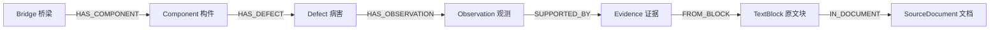

# 最小业务抽取契约

结构版本：旧 `0.1.0-draft` / `0.2.0-draft` 兼容；新增 `0.3.0-draft` 面积表达与派生。另增 `0.4.0-draft/catalog` 桥梁统一身份，面积沿1.3规则。当前catalog语义修订：**1.5（2026-10-16普通表格业务行证据闭环）**；主定义见[Spec014契约](../014-catalog-evidence/plan.md)，身份基础仍为1.4。历史抽取稳定性只适用于原冻结1.1.4/1.2，不能当作新版模型稳定性证据；[本轮计划/预期](../014-catalog-evidence/expectations.md)单独保存。

本文件是这份契约的阅读入口。机器结构定义以 [business.schema.json](business.schema.json) 为准；跨字段、分类、映射及证据含义以本文语义规则为准，JSON Schema 结构合法不代表语义已通过。结构与语义相互矛盾时先修正，不以任意一方静默覆盖。总体范围、文档/来源、状态和图存储约定分别引用 [PRD §4.3](../../PRD.md#43-mvp-业务模型范围)、[根 spec §5–7](../../spec.md#5-共用契约与标识)、[§9](../../spec.md#9-neo4j-模型写入与索引)。载荷 schema_version、本文语义修订和实验配置版本分别追踪；语义修订 1.1 不将载荷 schema_version 改为 1.1，不改原实验 1.0。本实验版本与根 spec 计划的正式 `schema_version=1.0` 分开，实验字段以本契约为准。

## 1. 审阅顺序与产物

1. 先读 §2–4，确认业务对象、字段及未知值。
2. 对照 [候选实例](examples/candidate.json) 与 [记录实例](examples/records.json)，观察模型与程序的职责边界。
3. 读 §5–7，确认身份、证据与图映射；反例见 [counterexamples.json](examples/counterexamples.json)。

本次新增规则优先读 **§4.4、§5.1、§6.1**；版本和实现边界见 §8.1。已有实例/反例属于原结构基线，不能据其结构检查宣称新语义已实现。

实例由 agent 按 [独立预期清单](../../samples/synthetic/bridge-demo-001/expected-facts.md) **人工组装**，不是模型抽取输出，也不是新的 golden。记录实例中的 `passed/accepted/unreviewed` 演示未来程序完成校验后的形态；**不代表当前已实现接纳流程或已获人工确认**。其中 block_id、原句、页码和坐标取自 [实际解析快照](../../experiments/docling-parse-001/results/normalized.json)，没有编造位置或改写原始预期清单。

## 2. 三个相互衔接的契约

| 契约 | 数据来源 | 作用 |
|---|---|---|
| 文档契约 | Docling → 项目适配层 | 保存内容块、表格结构和来源位置，沿用根 spec §6 |
| 候选契约，`stage=candidate` | 抽取模型 | 提交四类业务候选、对象关联和 `block_id + exact_quote` |
| 记录契约，`stage=records` | 校验与身份/证据程序 | 形成五类记录及明确状态；再按固定约定映射入图 |

一个 JSON Schema 用 `stage` 区分两种业务载荷，内部 `$defs` 复用字段定义，不复制成两份独立规范。顶层均含 `schema_version`、`document_id`、`source_kind`。文档 ID 和来源性质由可信导入上下文提供，模型只能照传，程序仍须核对。

`DoclingDocument`、`normalized.json` 是文档结构实例；业务 Schema 是上述业务载荷的字段/约束定义；`examples/*.json` 是该 Schema 的示例实例。它们不共用版本号。新一次观测是实例增加，字段含义改变才涉及 Schema 演进。

## 3. 业务对象与关系

只保留 Bridge、Component、Defect、Observation、Evidence；来源文档、原文块属于已有技术记录，不新增业务类型。



Bridge、Component、Defect 也可 `SUPPORTED_BY` Evidence。本阶段不建立 Measurement、评估、处治、维修或条款实体。Observation 的 `component_id` 由其 Defect 所属构件解析而来，校验两者一致；不另加一条可由模型随意改变的构件归属。

**Defect 是一个构件/位置上的可识别病害；Observation 是对它的一条观测。** 明确同一病害之后又有一次检测，应保留旧 Observation、新增新 Observation；没有身份依据不能自动合并。正文和表格重复描述相同原编号，只追加证据，不追加病害/观测。

## 4. 核心字段

机器定义中的键均须出现。候选中明确允许 `null` 的字段可以未知；正式记录的身份、必要名称、病害类型/位置不可空，不能确定则保留候选待处理。`required` 仅要求键出现，是否允许 `null` 由字段类型决定。

### 4.1 Bridge / Component / Defect

| 记录 | 核心业务字段 | 草案约束 |
|---|---|---|
| Bridge | `bridge_id`、`bridge_code`、`name` | ID 由程序解析，原始编号可空；名称不可空 |
| Component | `component_id`、`bridge_id`、`component_code`、`name`、`component_type`、`location_text` | 名称不可空；原构件编号在旧模式不可空，v0.2仅凭受控登记可null；类型/描述范围可空 |
| Defect | `defect_id`、`component_id`、`defect_code`、`defect_type`、`defect_type_raw`、`location_text`、`identity_scope` | 原病害编号可空；没有类型或可识别位置不得形成正式记录 |

- 类型暂限定 `pothole`=坑槽、`exposed_rebar`=露筋。候选另允许 `unknown`，保留 `defect_type_raw`；无法安全映射则待处理，不扩展枚举。
- 构件类型暂限定 `deck_pavement`=桥面铺装、`girder`=主梁，未知可空；保留原构件 `name`，不把行业构件层级引入本阶段。
- `location_text` 保留原文表达或有证据的简单映射；“两个露筋位置”各有独立 Defect。相似名称/位置不证明同一对象。

### 4.2 Observation

| 字段 | 类型/含义 | 缺失处理 |
|---|---|---|
| `observation_id`、`defect_id`、`component_id` | 程序生成/解析的引用 | 无法确定则候选待处理 |
| `observation_code` | 原观测编号；string/null | 没有原编号仍可由程序生成稳定 ID |
| `observed_at` | `YYYY-MM-DD` 或 null，仅观测日期 | null 时 `missing_fields` 必含 `observed_at` |
| `assertion` | 候选 positive / negative / suspected / unknown | 正式病害观测本阶段只允许 positive；其他保留原文/待处理 |
| `scope` | 候选 single_defect / aggregate / unknown | 正式记录只允许 single_defect；汇总不展开成多个可识别病害 |
| `reported_count` | 原文明确的处数；integer/null | 不由提及次数推算，正式单处记录只能为 1 或 null |
| `description` | 原始描述，非模型生成的评估/建议 | 必须有对应原文证据 |
| `area_original_value` | 非负十进制字符串或 null | 不允许 JSON float，不把未知填成 0 |
| `area_original_unit` | 原始单位字符串或 null | 未知单位不猜 m² |
| `area_value` | 程序校验/归一后的非负十进制字符串或 null | 不能计算时保持 null 并记录缺项 |
| `area_unit` | 规范指标单位，固定 `m²` | 表示这个字段的量纲，不表示原文提供了单位 |
| `area_conversion` | 旧版 identity/null；新版另有 unit_scale/rectangle_product/explicit_area_product | 直接单位换算或有依据的派生方法，不由模型计算 |
| `area_is_approximate` | boolean/null，保留“约”等限定 | 未知不当作 false；原句无近似限定时可提议 false，仍核对原文 |
| `missing_fields` | 可空业务字段名的去重列表 | 程序据实际缺项生成，模型不决定 |
| `source_kind` | real / synthetic | 继承来源登记，不能由虚构记录冒充 real |

数值校验与单位处理使用 Decimal。保留原始与规范值，程序核验两者及转换依据一致；字符串格式合法不代表该数值有证据。缺日期允许保留观测，按日期范围查询时排除并统计遗漏；报告编制日期保留在原文/来源资料中，不能写进 `observed_at`。

新版候选增加 `area_expression`（连续原文或null），正式记录增加 `area_expression`、`area_basis`、`area_derivation`、`area_rules_version`。直接面积保留原值/原单位，表达为空；尺寸/面积式推算原始标量保持null，程序记录两个输入、原始单位、因子、方法、结果和规则版本，不能拿推算值冒充原值。`area_basis`为reported/rectangle_dimensions/explicit_area_product/null。明确矩形长宽及单位或明示面积乘积才计算，最大/范围/不规则/缺单位不猜。派生面积的原值/原单位仍列missing_fields，但规范area_value已知时不列其缺项。

新版单位/术语别名、换算比例和限定词唯一配置于 [business-rules.json](../../src/ontology_proj/resources/business-rules.json)，固定Decimal计算/来源检验在程序。旧版保持原m²/㎡/m2语义，新版支持平方米/cm²/cm2/平方厘米/mm²/mm2/平方毫米及匹配空白/全角规范化，原块与引用不改。新根载荷identity_mode=explicit|registered；registered仍需本报告已确认登记，范围不扩到其他文档。设计/验收见[Spec011](../011-business-rules/plan.md)、[ADR-017](../../docs/adr/ADR-017-规则配置与可追溯面积派生.md)。

面积值/单位缺失或无法归一时，保留候选问题；具备明确对象及其他有效字段时可生成结构合格的 `pending_review` 记录，未知面积为 null。对象、肯定性或单处范围不明时，不进入本阶段记录载荷。不能把这类分流等同专业审核。

### 4.3 Evidence 与系统字段

Evidence：`evidence_id`、`document_id`、`block_id`、`page_no`、`bbox`、`charspan`、`quote`、`target_field`、`location_level`、`source_ref`，详细含义引用根 spec §6.3。本草案不要求逐字像素高亮。

- `bbox` 是左上角归一坐标 `[x0,y0,x1,y1]`；必须有真实页码/可验证区域，未知坐标不填占位框。
- `charspan` 是原始 `Block.text` 的 Unicode code point 范围或 null；存在时切片必须等于 `quote`。本样本实例使用 `region`，字符切片不代表逐字像素定位。
- 每个重要字段/关联有相应证据；同一 Observation 可关联多条 Evidence，例如面积、位置、观测编号及日期说明来自不同块。
- 四种业务记录均有 `source_document_id`、`evidence_ids` 和根 spec §7.1 的状态字段。本草案记录载荷只装结构合格的记录：`validation_status=passed`，`acceptance_status=accepted|pending_review`，`review_status=unreviewed|confirmed`；pending_review 必为 unreviewed。
- `quality_mode` 沿用现有演示策略枚举，`quality_score=null`。专业审核/数值置信度没有在本阶段实现。失败/结构不合格的对象保留在候选快照和程序诊断中，不挤入正式类型。
- 本阶段取自 PDF 的每个业务对象都须有 evidence_ids。根 spec 中“桥梁可由明确导入上下文提供身份”的例外仍可用于 ID 解析，但不扩展本草案为无证据对象导入接口。

### 4.4 位置规范：桥头部位与构件分开（语义修订 1.1）

当前已验证的 synthetic 样本中，桥面铺装的桥头位置采用下列局部规则，不扩展成通用行业词典：

| 原文位置表达 | 记录载荷的业务位置 | 所属构件 |
|---|---|---|
| 桥头 / 桥头区域 / 桥头铺装 | 桥头区域 | 桥面铺装 C-DECK-01 |

适用条件：同一文档有明确桥面铺装身份及原文依据，且位置用于描述该构件的桥头区域。仅看到“桥头”不能猜构件编号；不把第三跨、主梁或含方向/距离的其他表达套入此映射。Component.location_text 的描述范围（如“第三跨桥面、桥头区域”）不因此整体替换。

模型候选的 location_text 优先保留实际原文位置表达；程序在形成记录时应用上述已批准映射，统一为“桥头区域”。Statement.text、Observation.description、Block.text、sources.exact_quote 及 Evidence.quote 不随映射改写。“桥头铺装”中的构件含义由独立 component_ref/component_id 表示，不另造位置或新业务实体。

位置字段来源仍使用 target_field=location_text，引用原文中确实存在的“桥头铺装”等文字；程序以本文映射核验它对规范值的支撑，不能要求或伪造原块中不存在的“桥头区域”引文。可追溯依据是原文位置引文、已验证组件关联和语义规则版本三者；不增加 payload 字段。未知或超出规则的表达保留原文，不强制套用别名，不因此建立新位置关联。

独立验收比较的是程序生成的规范位置；候选原文表达与原始证据仍单独核验。实验 1.0 的既有预期及失败记录保持原样，未来新版验收须在运行前注明采用本规则。

## 5. 候选：模型能做什么

`entities[]` 仅允许 Bridge、Component、Defect、Observation；每项有 `local_id`、`entity_type`、类型对应的 `data`、`sources[]`。候选 data 保存原始字段，不包含正式 ID、identity_scope、规范面积、Evidence、接纳/审核状态或数值评分。

`relations[]` 仅允许三个关联候选：

| 关系 | 起点 → 终点 | 单一归属规则 |
|---|---|---|
| HAS_COMPONENT | Bridge → Component | 每个构件恰有一个桥梁父对象 |
| HAS_DEFECT | Component → Defect | 每个病害恰有一个构件父对象 |
| HAS_OBSERVATION | Defect → Observation | 每条观测恰有一个病害父对象 |

关系的 `from_ref/to_ref` 只引用本候选包的 local_id，禁止任意数据库 ID。此阶段没有跨批次或已有图对象接口；以后需要时经受控导入映射扩展。正式关系由程序按校验过的关联生成，不执行模型提供的 Cypher。

每个 `sources[]` 项有 `block_id`、`exact_quote`、`target_field`、`occurrence_hint`（非负整数或 null；同块从 0 起的匹配序号）。target_field 应对应实际业务字段或关联端点，不是自由添加属性名。程序需校验名称、源块与字段支撑关系；JSON Schema 只约束其基本形状。

否定/疑似/汇总或无法表示的陈述放入 `statements[]`，保存 kind、component_ref（可空）、location_text、text、sources。本样本桥头否定句在这里保留，不创建 Defect 或强行挂到病害的 Observation。**Statement 是载荷中的原文分类，不是第六种业务实体或独立图节点。** 正式载荷中的 component_ref 由程序替换成 component_id；原句仍以固定原文块为权威。

`issues[]` 保存问题、关联 local_id 与原因；模型提议的问题不替代程序判定。候选结构不合法时程序可保存原始响应并生成独立诊断，不能为强行通过而丢弃字段。本草案 JSON Schema 不是某个 provider 的提示词/结构化输出语法；接入时核验其支持的子集，不能因此削弱业务约束。

### 5.1 检测事实与说明文字的分类（语义修订 1.1）

分类依据是整句在上下文中的用途，不是是否出现“不”“无”“未”“全桥”等词。

| 原文用途及当前实例 | kind | 业务含义 |
|---|---|---|
| 实际检测否定：“桥头铺装平顺，未见明显病害。” | negative | 仅该构件/位置的否定发现，不生成肯定 Defect/Observation |
| 实际检测否定：“第三跨主梁中部未见露筋。” | negative | 主梁中部的否定发现，不扩展为整根主梁无病害 |
| 范围说明：“桥头的否定陈述仅针对桥头区域，不表示全桥无病害。” | unmapped | 解释记录的使用范围，不是新增检测发现 |
| 日期说明：“表中两条观测的日期均未知……” | unmapped | 表示缺项，不产生新的观测或检测日期 |
| 去重说明：“正文与表格描述相同编号的记录，不表示新增病害或新增观测。” | unmapped | 解释重复提及，不是病害统计，也不是检测否定 |

表中引文用于解释语义；实际输出 text/exact_quote 必须使用该份 Block.text 中的连续原文，包括真实换行连接空格，不可直接复制表中整理后的句子。

原文中的真正疑似发现仍为 suspected，真正的病害统计/汇总仍为 aggregate；使用说明、编号说明和日期说明不得仅凭数量或“全桥”等词变成 aggregate。不能安全判断的陈述保留为 unmapped 并给出候选问题，不擅自断言肯定病害或明确否定。

已提取的说明文字放入 statements，不新增业务节点；说明条目数不固定，不要求穷举每个排版/演示说明。日期明确未知仍应给已有观测 observed_at=null 并保留缺项及原文证据，不因其属于 unmapped 而丢弃日期信息。分类为 unmapped 不免除 text、sources 或明确关联的校验。

## 6. 身份与可回查证据

文档 ID 采用根 spec 的 `doc_ + SHA-256`。示例源快照是实验格式，document_id 为裸摘要，block_id 为实验稳定摘要；示例映射加 doc_ 前缀，复用真实块快照，并在核验时比较摘要。以后正式适配需生成根 spec 的块标识并维护 source_ref，不能默默改变旧引用。这个差异未修改原实验产物。

| 对象 | 草案生成/解析依据 | 保护边界 |
|---|---|---|
| Bridge | 可信导入上下文的桥梁 ID，或经证据确认的明确桥梁编号 | 无法确认不按名称合并 |
| Component | 桥梁 ID + 原构件编号的规范序列化摘要 | 不同桥梁中的 C01 不碰撞 |
| Defect | 默认文档 ID + 原病害编号；无编号时稳定局部候选标识 | 默认 document_local；同一份 PDF 内 D-001 不能证明跨文档身份 |
| Observation | 文档 ID + 去重后的稳定候选 local_id | 同文件重试复用候选快照；正文/表格同编号提及先去重再生成 ID |
| Evidence | 来源位置、目标字段、原句的规范序列化摘要 | 位置变更生成新记录，不修改旧引用 |

`identity_scope=explicit` 仅在跨文档身份有明确、可信的标识或人工固定映射时使用；模型不能选择。示例中三个 D-xxx 均为 document_local。canonical JSON 固定键顺序、UTF-8、数值精度；不能只用中文描述作为键。

模型只选择现有 block_id 与 exact_quote。程序计算匹配字符范围、转换坐标并生成 Evidence；多次匹配无可核验提示则待处理，零匹配拒绝；不让模型猜页码或 bbox。表格关联必须保留行列与表题上下文；本次 Docling 表头标记与 caption 关联缺失，不能只看这些原生标记。

### 6.1 说明文字的可选组件关联与上下文证据（语义修订 1.1）

unmapped 说明允许 component_ref=null；location_text 未明确提供时也为 null。模型不需要为每段说明强行指定组件。不关联组件只免除组件关联证据，text/description 和 kind 的原文支撑仍须核验；不能借此省略实际 negative 陈述在当前样本中已有的构件/位置。

若 component_ref 非空，它在候选中须指向同包 Component.local_id，在记录中由程序替换为已核验的 component_id；sources 必须包含明确支撑该关联的 target_field=component_ref 证据。两种可接受的依据为：

1. 本句直接指出可确认的组件编号或名称，并能与同包组件身份相对应。
2. 本句是某张表的紧邻说明，引用该说明段落及明确指向该表/组件的表题、编号或相关原文块，例如带“构件 C-GIRDER-01”的表 4 表题。分别保存现有 block_id/exact_quote，不拼成虚构连续引文。

对第二种情况，程序必须在**同份解析快照**中核查阅读顺序、页码、表号/表格及组件编号：当前样本限同页紧邻的表后说明，表与说明之间不能隔着另一张表或新的业务小节，不能跨到其他组件。表题中的编号必须与候选组件一致；不能仅因“主梁”一词出现在文档其他地方而关联。原生 caption 引用缺失时可以使用已保存的表题文本、表格 source_ref 与读取顺序核查，不能伪造原生 caption 关联。

说明自身含有“表中两条观测”等限定，只有与明确的邻接表及组件身份共同形成证据链，才支持主梁关联。允许该说明本句不含“主梁”；不再把本句出现构件关键词作为唯一硬条件。仅引用说明的 description/kind，或只有组件表题而没有说明归属依据，都不足以通过 component_ref 校验。

无法唯一回查、来源冲突或编号不一致时保留候选及诊断，不猜关联、不自动擦除模型已经提议的非空 component_ref 来强行放行。候选主动选择 null 合法，与程序事后删除错误关联不同。具体错误恢复策略仍沿用现有实验边界，本次没有实现逐对象恢复或改变整包拒绝机制。

## 7. 图映射与校验分工

Bridge、Component、Defect、Observation、Evidence 对应固定标签；关系固定为 §3 中的类型。身份/所属字段在 JSON 中方便跨模块传递，在图中展开为节点属性及固定关系；程序保证两者一致。此阶段只定义映射，不连接 Neo4j。

| JSON 内容 | Neo4j 映射 |
|---|---|
| 名称、编号、类型、原始描述、面积原值/规范值/单位/转换 | 对应节点明确的标量属性，不放任意嵌套 measurements 对象 |
| observed_at 已知 | 转为 DATE；未知在 JSON 中 null，图中无该属性，missing_fields 保留 |
| area_value 等数值 | 先存规范十进制字符串，保留精度；数值阈值/聚合查询不属于本次草案验收，需要时明确数值投影再验证 |
| bbox / charspan / missing_fields | 同类型数值/字符串列表；charspan null 不写图属性 |
| evidence_ids、对象引用 | 解析成固定关系；完整复杂表格与候选 issues 保存在文件 |
| 原始文档 / 块 | 按根 spec SourceDocument / TextBlock 技术节点连接，完整原生 JSON 不整包塞进节点 |

每种主 ID 配置独立唯一约束；示意 `CREATE CONSTRAINT bridge_id_unique IF NOT EXISTS FOR (n:Bridge) REQUIRE n.bridge_id IS UNIQUE`。唯一约束不保证属性必填或关系基数；这些与业务语义仍由程序校验。Neo4j Community 基线不依赖 Enterprise 的必填/类型约束。

| 校验层 | 本阶段定义的职责 | 当前是否实现 |
|---|---|---|
| JSON Schema | 字段、类型、枚举、额外字段、日期格式、部分 null/缺项和状态组合 | 草案与实例结构检查可运行 |
| 确定性校验程序 | ID 唯一/引用/关系两端与父对象、来源继承、字段支撑、原文匹配、bbox/charspan、Decimal/单位/缺项一致、记录去重 | 应用已迁入含 1.1 分类/位置/上下文检查；核心不变，应用/图/恢复共 158 项检查通过；不是通用语义校验器 |
| 独立事实对照与人工审核 | 否定/疑似/汇总含义、表题关联、观测日期依据、跨文档身份及模型漏抽/误抽 | 用户已确认核心基线；最新 1.1.4 五份受控素材独立首次 10/10；前轮失败保持原样，用户逐条专业审核与复杂报告未验证 |
| 数据库 | 唯一约束、固定写入和事务 | S2.3 实际 Neo4j 唯一约束、幂等、回滚及缺项/冲突 pending 检查通过；不代表复杂报告或跨文档身份能力 |

JSON Schema 的 date 需要验证器启用 format 检查；普通 required 不会自动禁止 null。跨对象引用、值是否得到原句支持等不能仅靠结构校验宣布正确。

## 8. 正反例、核验与待确认取舍

完整实例包含 1 Bridge、2 Component、3 Defect、3 Observation，面积 0.04/2.6/0.9 m²、观测日期均未知，另保留桥头否定陈述。每个肯定对象对应同编号记录，没有按正文与表格提及次数重复建对象。

[verify_contract.py](verify_contract.py) 只核验草案/例子：Schema 自检、正例结构、结构反例、展示结构无法判定的反例、引用与位置实际存在、与原始预期清单的一致性。结果见 [verification.json](verification.json)。它不调用模型、不写数据库、不包含自动业务语义判定，也不更新 golden。

```bash
experiments/docling-parse-001/.venv/bin/python specs/001-business-extraction/verify_contract.py
```

使用已安装的 jsonschema（本机实验锁中版本 4.26.0）；没有安装新依赖。可以在任何包含 jsonschema 的 Python 环境中运行。

**已认可的实验设计取舍：** 字段及枚举命名；面积三个等价单位写法且暂不做量纲换算；Defect 默认文档内身份；未知日期可接纳而未知面积分流；否定/疑似/汇总保留为原文分类；十进制字符串及当前不实现数值图查询。用户已认可整体设计，现用于单样本实验；其他病害类型、测量指标、跨文档融合及正式应用迁入以后需要时再讨论。现有 verify_contract.py 保持手工草案核验职责，真实模型校验见实验的 validate.py，不混用其成功含义。

### 8.1 修订与实施状态

**当前实施状态**见本文件开头和 [S2.2 复验](../002-ingestion-foundation/results/s2.2/stability-followup.md)：应用规则已迁入，最新基线首次 10/10。以下条目保留契约确认当轮的历史范围，不代表最新进度；旧实验文件仍未改。

2026-10-11 用户依次确认 §5.1 的说明分类、§4.4 的局部位置规范，以及 §6.1 的可选组件关联/上下文证据。本次语义修订为 1.1；规则的来源是这些确认，不是为了让已有失败自动变成通过。

- business.schema.json 的字段、枚举、null 约束及载荷 schema_version 保持 0.1.0-draft；现有 Statement/sources 能表达上述规则，不增加原始位置字段或新实体。语义版本由契约和未来实验配置记录。
- 本轮仅更新契约及入口说明；提示词、validate.py、evaluate_suite.py 和原实例未修改。现有校验程序尚不具备 1.1 位置规范及上下文证据检查能力，现有手工结构核验也不能证明这些语义已实现。
- 受控实验配置 1.0、预期 1.0、十次原始响应和三次首次未通过保持不变，见 [验收记录](../../experiments/business-extraction-variants-001/results/review.md)。不将新规则回填为原实验“已通过”。
- 下一步需同步提示词、确定性程序及新版独立预期，记录适用规则和变更理由，建立新的实验基线 1.1；先做针对分类、映射、证据与反例的离线核验，再按用户后续指令进行五份素材十次独立调用。本轮尚未冻结该新基线或调用模型。

## 9. 官方依据

- [JSON Schema 2020-12 Validation](https://json-schema.org/draft/2020-12/json-schema-validation)：required/type、条件约束和 format 校验边界。
- [Neo4j 属性类型](https://neo4j.com/docs/cypher-manual/current/values-and-types/property-structural-constructed/)：属性支持标量及同类型列表，不支持任意嵌套 map。
- [Neo4j 约束](https://neo4j.com/docs/cypher-manual/current/schema/constraints/create-constraints/)：唯一约束与必填/类型约束的作用及版本权益边界。

官方入口于 2026-10-10 核对；本文件是本项目设计，不是这些工具的原生业务 Schema。未改变 PRD 的范围，未修改原 PDF、解析结果、预期清单或历史讨论。

## 9. 受控人工登记（语义1.2）

用户明确批准胜利大桥、桥面铺装、3-1#左侧腹板、3-1#挑臂内部固定登记；后两者类型保持null、未提供纸面编号仍null、不按名称跨报告合并。决定及来源边界见[ADR-015](../../docs/adr/ADR-015-受控人工身份与原文编号分离.md)。

0.2.0-draft候选/记录必须绑定同一real文档的confirmed_by_user登记表及可信桥梁导入上下文。登记含版本、文档ID、内部记录ID/父ID、原文名称/别名、连续来源及明确源窗口；配置identity_registry_path位于DATA_ROOT内并以identity_registry_sha256固定字节。状态文字不是专业审核签名；本机可信操作员的登记权限与专业终审分开。原code不得用技术标签补齐。其他未登记身份拒绝/待处理，旧0.1仍沿明确原编号规则；配置登记的同文档不得用旧版本绕过。

受控关系由登记父身份及原文quote共同支撑。观测字段quote必须在该登记源窗口内，数字通过面积标记S=或面积语句核验，不能引用同单元格另一位置的值；无编号表行不再仅因own_code=null拒绝，但窗口外/跨位置仍拒绝。确定的单处位置中明确病害描述可支持肯定单处，否定/疑似/汇总不转肯定。statement可使用已登记的原文归属范围证明构件关联，不猜其他无依据关联。

Bridge/Component技术ID由受控登记提供；Defect键包含document_id、登记component_id、仅用于身份键的紧凑位置及类型；Observation键含document_id、defect_id和实际日期或null。原业务字段/quote不改。相同位置重复提及应合并来源，重复正式ID拒绝，不静默丢模型对象。Defect仍document_local；不将源窗口或未确认名称作为跨文档身份。

面积unit采用compact空白后核对既有m²/㎡/m2，保留area_original_unit原写法（包括m 2）及原值，规范单位仍m²、比例1。不新增长度/强度或其他面积单位。candidate字段/类型/关系错误整包拒绝，不能用人工测量答案补候选。新格式结构变化已同步两个Schema；旧产物不改、新运行独立冻结。实施/验证见[Spec009](../009-controlled-registration/plan.md)。

仅对0.2已登记的完整“经检查，桥头平顺，未见明显病害。”范围（允许明确前缀/原句标点），在description/kind/component_ref均引用同一连续原句且合法绑定构件时，程序可从该句派生正式statement.location_text=桥头，并追加程序来源和审计issue。原模型candidate的null不改；不完整句、冲突位置、窗口外或无登记仍拒绝，正式记录再校验。此为既有UT-14位置派生的受控实现，不新增专业推断；原拒绝保留，新无网络验证运行独立记录。


## 10. 桥梁统一身份语义1.4

新0.4.0-draft必须identity_mode=catalog并有可信来源快照绑定。每座登记桥一个稳定brg_技术ID，原始bridge_code有则保留、无则null，官方属性附编号体系；模型不得输出技术ID冒充纸面编号。已有桥选择、原文官方体系/编号、唯一精确桥名/完整地理位置可确定归属，后者自动关联无需人审。冲突/多候选/缺信息需确认，不自动创建或把相似名称合并。来源字段发现/规范化及确定边界由[Spec012计划](../012-bridge-identity/plan.md)维护。

候选桥名称/原编号须同时满足实际原文证据与可信绑定，恰好一个桥；已绑定文档不得降级旧显式身份模式。桥原编号为空时，HAS_COMPONENT可由同一连续原文quote中的桥名称与明确构件编号共同支撑；语义1.5另允许[Spec014](../014-catalog-evidence/plan.md)规定的可信报告绑定与分别引用原桥名、普通行完整构件编号的路径，不能仅因已登记桥而接纳无关系证据的构件。构件ID由document_id、内部bridge_id、原component_code生成，不因跨报告统一桥就合并构件；无原构件编号暂仍待处理。无病害/观测原编号的普通行证据、构件与部位粒度以Spec014为主定义；面积与原文定位规则不放宽。

旧0.1–0.3正式记录可读不重新编号；旧受控登记仅路由其document_id，不把名单套在新报告。Neo4j桥节点维护统一显示身份，文档原始编号/引用留在各份正式记录及绑定审计；SourceDocument.bridge_id写统一归属，同时保存原上传上下文用于重复上传校验。已有发布资料复用旧结果，不自动迁移或合并旧技术ID。本地出版及来源校验通过的旧桥接入登记目录时沿用原ID，便于新报告选择；无本地证明的图对象不接入。人工明确核对可确认名称/位置显示差异，不改原始字段或登记名称；官方编号及其他确定候选冲突仍停止。设计理由见[ADR-018](../../docs/adr/ADR-018-桥梁统一身份与报告归属.md)。
